# SIPANA: Dokumen Desain Sistem

**Sistem Informasi Pangan Berlebih Berbasis Web untuk Penyaluran Sisa Makanan UMKM Kuliner kepada Masyarakat di Kabupaten Karawang**

Kelompok 6 | Mata Kuliah Komputer dan Masyarakat | Informatika, Universitas Singaperbangsa Karawang
Dosen Pengampu: Rini Mayasari, S.Kom., M.Kom.

> Dokumen ini disusun dari **hasil survei awal (25 responden: 11 UMKM dan 14 masyarakat)**. Setiap fitur, aturan bisnis, dan keputusan desain diberi rujukan ke data survei, supaya bisa dipertanggungjawabkan di laporan tugas maupun naskah jurnal.
>
> Diagram memakai **Mermaid**. Bisa dirender di GitHub, VS Code (ekstensi *Markdown Preview Mermaid Support*), Notion, atau tempel kode ke <https://mermaid.live> lalu ekspor PNG/SVG untuk laporan.

---

## Daftar Isi

1. [Ringkasan Eksekutif](#1-ringkasan-eksekutif)
2. [Rekap Data Survei](#2-rekap-data-survei)
3. [Temuan Kunci yang Mengarahkan Desain](#3-temuan-kunci-yang-mengarahkan-desain)
4. [Konsep Website](#4-konsep-website)
5. [Fitur Berdasarkan Data Survei](#5-fitur-berdasarkan-data-survei)
6. [Kebutuhan Fungsional dan Non-Fungsional](#6-kebutuhan-fungsional-dan-non-fungsional)
7. [Aturan Bisnis](#7-aturan-bisnis)
8. [Use Case Diagram dan Spesifikasi](#8-use-case-diagram-dan-spesifikasi)
9. [Activity Diagram](#9-activity-diagram)
10. [ERD (Entity Relationship Diagram)](#10-erd-entity-relationship-diagram)
11. [Skrip Database (SQL)](#11-skrip-database-sql)
12. [Rancangan Antarmuka & Design System](#12-rancangan-antarmuka--design-system)
    - 12.1. [Filosofi Desain Landscape Web & Aksesibilitas](#121-filosofi-desain-landscape-web--aksesibilitas)
    - 12.2. [Identitas Visual & Palet Warna](#122-identitas-visual--palet-warna)
    - 12.3. [Tipografi & Skala Hirarki](#123-tipografi--skala-hirarki)
    - 12.4. [Konfigurasi Tailwind CSS v4 (`index.css`)](#124-konfigurasi-tailwind-css-v4-indexcss)
    - 12.5. [Pola Navigasi & Komponen UI Kunci](#125-pola-navigasi--komponen-ui-kunci)
    - 12.6. [Wireframe Teks Halaman Inti (Landscape Web Layout)](#126-wireframe-teks-halaman-inti-landscape-web-layout)
    - 12.7. [Katalog Lengkap Seluruh Halaman Sistem (Blueprint Prototype UI/UX)](#127-katalog-lengkap-seluruh-halaman-sistem-blueprint-prototype-uiux)
    - 12.8. [Spesifikasi Detail Layar & Pemisahan 2 Tampilan Antarmuka (Penerima vs UMKM)](#128-spesifikasi-detail-layar--pemisahan-2-tampilan-antarmuka-penerima-vs-umkm)
    - 12.9. [Panduan Pembuatan Prototype Figma & Arsitektur Rute Middleware](#129-panduan-pembuatan-prototype-figma--arsitektur-rute-middleware)
13. [Arsitektur Teknologi dan Fullstack Implementation](#13-arsitektur-teknologi-dan-fullstack-implementation)
14. [Indikator Keberhasilan dan Data yang Dicatat Sistem](#14-indikator-keberhasilan-dan-data-yang-dicatat-sistem)
15. [Skenario Pengujian (Black-Box)](#15-skenario-pengujian-black-box)
16. [Batasan dan Pengembangan Lanjutan](#16-batasan-dan-pengembangan-lanjutan)
17. [Rencana Kerja sampai November](#17-rencana-kerja-sampai-november)
18. [Catatan Sinkronisasi dengan Laporan Sebelumnya](#18-catatan-sinkronisasi-dengan-laporan-sebelumnya)

---

## 1. Ringkasan Eksekutif

**SIPANA** adalah website yang menghubungkan **UMKM kuliner di Karawang** (pemberi) dengan **masyarakat umum Karawang** (penerima) untuk menyalurkan sisa dagangan yang masih layak, secara **gratis**, sebelum batas waktu ambil habis.

| Aspek | Penjelasan |
|---|---|
| **Masalah** | Penyaluran sisa dagangan UMKM masih informal (diberikan ke orang sekitar atau dibagikan ke tetangga/karyawan), tidak terstruktur, dan tidak terjangkau masyarakat yang lebih luas. Masyarakat tidak punya media untuk tahu dan mengambilnya dengan aman. |
| **Pemberi** | UMKM kuliner terverifikasi (dalam data survei: 82% penjual kue/roti/jajanan) |
| **Penerima** | Masyarakat umum Karawang. Boleh memakai sendiri, menyalurkan lagi ke yang membutuhkan, atau memanfaatkan sebagai pakan ternak (sesuai label peruntukan) |
| **Pembeda** | Keamanan pangan sebagai inti (verifikasi UMKM, jam masak, label peruntukan, tombol lapor, persetujuan syarat dan ketentuan), kuota klaim, konfirmasi serah terima, rekap dampak |
| **Cakupan awal** | Kabupaten Karawang, uji coba di Karawang Barat, Telukjambe Timur, dan Karawang Timur (kecamatan asal responden) |
| **Di luar cakupan** | Donasi uang, pembayaran, pengiriman makanan, aplikasi mobile, wilayah di luar Karawang |

---

## 2. Rekap Data Survei

Sumber: ekspor Google Form per **19 Oktober 2026**. Total **25 responden** (11 UMKM, 14 masyarakat).

> **Peringatan metodologi:** sampel kecil dan non-probabilitas (disebar lewat jaringan kelompok). Hasil menggambarkan kondisi awal dan **tidak dapat digeneralisasi** ke seluruh Karawang. Responden cenderung menjawab positif untuk ide baru, jadi persentase minat tidak boleh dibaca sebagai bukti mutlak.

### 2.1 Profil responden

| Kelompok | Rincian |
|---|---|
| **UMKM (n=11)** | Jenis: penjual kue/roti/jajanan 9, katering 1, kafe/kedai kecil 1. Lokasi: Karawang Barat 5, Telukjambe Timur 4, Karawang Timur 2. Lama usaha: >5 tahun 4, 3-5 tahun 2, 1-3 tahun 2, <1 tahun 3 |
| **Masyarakat (n=14)** | Pekerjaan: pekerja pabrik/kawasan industri 6, karyawan lain 3, wiraswasta 3, ibu rumah tangga 2. Domisili: Karawang Barat 5, Telukjambe Timur 4, Karawang Timur 3, Klari 2 |

### 2.2 Hasil kelompok UMKM (n=11)

| Pertanyaan | Hasil | Proporsi |
|---|---|---|
| Frekuensi dagangan tidak habis | Hampir setiap hari 4, 2-3 kali seminggu 5, jarang 2 | **9/11 (82%)** minimal 2-3x seminggu |
| Rata-rata sisa per hari | 1-5 porsi: 7, 6-10 porsi: 3, tidak ada: 1 | 10/11 (91%) punya sisa; semuanya **di bawah 10 porsi** |
| Jenis sisa terbanyak | Kue/roti/jajanan 9, makanan matang 1, sisa olahan 1 | 9/11 (82%) kue/roti |
| Sisa diapakan | Diberikan ke yang membutuhkan 7, dibagikan ke tetangga/karyawan 3, disimpan di freezer 1, **dibuang 0** | 10/11 (91%) penyaluran informal |
| Sisa sudah pasti pada jam | Sebelum 15.00: 8, 15.00-18.00: 1, setelah 21.00: 2 | 8/11 (73%) sebelum 15.00 |
| Kesediaan memberi gratis (skala 1-5) | Skor 5: 5, skor 4: 3, skor 1: 3 | Rata-rata **3,64**; skor 4-5: 8/11 (73%) |
| Keraguan (pilihan ganda) | Takut penerima sakit dan dituntut 6, khawatir merusak citra 3, repot mengurus 3, tidak ada keraguan 4 | **6/11 (55%)** takut dituntut |
| Bersedia memakai website SIPANA | Ya 4, mungkin (tergantung kemudahan) 7, tidak 0 | 0 penolakan; 7/11 (64%) bersyarat |
| Fitur paling dibutuhkan (pilihan ganda) | Posting cepat 7, konfirmasi serah terima 5, pilihan peruntukan 5, penerima terverifikasi 5, notifikasi 1, riwayat dan laporan 1, syarat dan ketentuan 1 | Posting cepat 64%; tiga fitur berikutnya 45% |

**Saran bebas UMKM (ringkas):** hubungkan ke WhatsApp ("agar bisa link ke WA", "bisa chat ke WA"); paparkan alur penerimaan dan distribusi supaya produsen mengerti manfaat dan jalurnya; website harus mudah dipakai ("website nya mudah di pakai", "mudah dipakai"); memudahkan penjualan.

### 2.3 Hasil kelompok masyarakat (n=14)

| Pertanyaan | Hasil | Proporsi |
|---|---|---|
| Melihat makanan layak terbuang | Sering 4, kadang-kadang 5, jarang 4, tidak pernah 1 | 9/14 (64%) sering/kadang |
| Pernah memperoleh makanan gratis/murah dari sisa UMKM | Pernah 5, tidak pernah 9 | 9/14 (64%) belum pernah |
| Cara tahu info makanan gratis | Melihat langsung 5, media sosial 4, tidak pernah tahu 4, grup WhatsApp 1, teman/tetangga 1 | Tidak ada kanal terpusat |
| Tahu platform penyaluran sisa makanan | Tidak tahu 11, tahu tapi belum pernah memakai 3 | 11/14 (79%) tidak tahu |
| Rencana pemanfaatan (pilihan ganda) | Diberikan lagi ke yang membutuhkan 8, pakan ternak 3, dikonsumsi sendiri/keluarga 2, tidak akan memakai 3 | Peran "penyalur ulang" dominan |
| Minat memakai SIPANA (skala 1-5) | Skor 5: 6, 4: 4, 3: 3, 1: 1 | Rata-rata **4,0**; skor 4-5: 10/14 (71%) |
| Manfaat bagi Karawang (skala 1-5) | Skor 5: 11, 4: 1, 3: 2 | Rata-rata **4,64**; skor 4-5: 12/14 (86%) |
| Jarak bersedia mengambil | <500 m: 6, 500 m-1 km: 5, 1-3 km: 2, >3 km: 1 | **11/14 (79%) ≤1 km** |
| Keraguan (pilihan ganda) | Keamanan/kebersihan 5, takut basi 3, privasi data 2, malu mengambil gratis 2, jarak 2, tidak ada 6 | 8/14 (57%) punya keraguan |
| Jaminan yang menambah kepercayaan | UMKM terverifikasi 7, foto jelas 3, cari per kecamatan 2, label peruntukan 1, jam masak 1 | **7/14 (50%)** verifikasi UMKM |
| Bersedia jadi relawan/penyebar info | Ya 5, mungkin 8, tidak 1 | 13/14 (93%) ya/mungkin |

**Saran bebas masyarakat (ringkas):** pisahkan makanan berkuah dan makanan kering; sosialisasi langsung ke masyarakat; semua pihak harus terverifikasi untuk menumbuhkan kepercayaan; jaga kebersihan dan kelayakan sisa makanan; kembangkan ke berbagi sembako, pakaian layak pakai, dan barang lain (di luar cakupan sekarang).

---

## 3. Temuan Kunci yang Mengarahkan Desain

| # | Temuan | Implikasi desain |
|---|---|---|
| T1 | **Tidak ada UMKM yang membuang sisa**, 91% sudah menyalurkan secara informal. | Masalahnya bukan "makanan dibuang" tetapi **penyaluran tidak terstruktur dan tidak terjangkau**. Rumusan masalah dan narasi laporan harus memakai sudut ini. SIPANA mencatat dan memperluas jangkauan penyaluran. |
| T2 | **Rasa takut dituntut** dipilih 6/11 UMKM. Rata-rata skor kesediaan yang takut dituntut = **2,67**, yang tidak takut = **4,8**. | Perlindungan hukum ringan adalah syarat adopsi: syarat dan ketentuan, pernyataan penerima, log persetujuan, label jam masak. Tampilkan di fitur prioritas **Tinggi**. (Catatan: hanya 1 UMKM yang memilih "syarat dan ketentuan" di daftar fitur, tetapi pertanyaan keraguan menunjukkan kebutuhan yang jauh lebih besar. Gunakan keduanya sebagai bukti.) |
| T3 | **82% sisa berupa kue/roti/jajanan** dengan **1-10 unit** per hari; 73% sudah pasti sebelum pukul 15.00. | Satuan tidak boleh hanya "porsi" (tambahkan pcs, bungkus, kotak). Kuota kecil, maka batas klaim per orang kecil. Posting dilakukan siang, ambil sore. Makanan kering lebih tahan lama. |
| T4 | **64% UMKM bersyarat** ("mungkin, tergantung kemudahannya"); 3/11 khawatir "repot mengurus". | Posting harus cepat (target ≤2 menit), mobile-first, klaim otomatis tanpa persetujuan UMKM, UMKM hanya perlu menekan **"Sudah diambil"**. |
| T5 | UMKM dan masyarakat sama-sama meminta **WhatsApp**. | Tombol WhatsApp jadi kanal komunikasi utama, tanpa fitur chat internal. Klaim tetap dicatat di sistem supaya data tidak hilang. |
| T6 | **Verifikasi UMKM** adalah jaminan nomor satu masyarakat (50%). | Registrasi UMKM harus lewat verifikasi admin sebelum bisa memposting. |
| T7 | **79% bersedia mengambil ≤1 km**; 6/14 hanya <500 m. | Filter kecamatan sebagai MVP. Simpan koordinat opsional untuk radius jarak di tahap berikutnya. |
| T8 | Keraguan masyarakat didominasi **keamanan/kebersihan (5)** dan **basi (3)**. | Foto jelas, jam masak wajib, batas ambil jelas, tombol lapor, info penyimpanan. |
| T9 | **Privasi (2) dan malu mengambil gratis (2)**. | Nomor WhatsApp penerima hanya terlihat oleh UMKM yang diklaim. Bahasa antarmuka netral ("ambil", bukan "minta gratisan"). Tidak ada daftar publik nama penerima. |
| T10 | **Pemanfaatan beragam**: diberikan lagi 8, pakan 3, sendiri 2. | Label peruntukan (konsumsi / pakan / keduanya) dan pemisah **kering vs berkuah** wajib saat posting. |
| T11 | **13/14 bersedia/mungkin jadi relawan**; saran sosialisasi langsung. | Halaman edukasi "Cara Kerja" di MVP; pendaftaran relawan penyalur di tahap 2. |
| T12 | 11/14 belum tahu platform serupa; kanal info saat ini acak (lihat langsung, medsos). | Beranda publik tanpa login supaya mudah dibagikan di WhatsApp dan Instagram. |

---

## 4. Konsep Website

### 4.1 Nama dan tagline

- **Nama:** SIPANA (Sistem Informasi Pangan Berlebih)
- **Tagline usulan:** *"Sisa dagangan, jadi berkah warga."*
- **Nada bahasa:** hangat, sopan, memakai sapaan **Akang/Teteh**, konsisten dengan survei. Hindari kata yang merendahkan.

### 4.2 Aktor

| Aktor | Peran | Hak akses |
|---|---|---|
| **Pengunjung** | Siapa pun yang membuka website tanpa login | Lihat daftar dan detail makanan, cari/filter, baca cara kerja dan syarat |
| **Penerima** | Warga Karawang yang sudah mendaftar | Semua hak pengunjung + klaim, riwayat klaim, lapor, feedback, daftar relawan |
| **UMKM (Pemberi)** | Pemilik/pengelola UMKM kuliner **terverifikasi** | Kelola profil usaha, posting, kelola klaim, konfirmasi serah terima, dashboard rekap |
| **Admin** | Tim SIPANA | Verifikasi UMKM, moderasi laporan, kelola data master dan syarat, rekap sistem |
| **Sistem (penjadwal)** | Proses otomatis | Ubah status kedaluwarsa, kembalikan kuota, kirim pengingat (tahap 2) |

Satu akun hanya memiliki satu peran utama (penerima atau UMKM). UMKM yang ingin mengambil makanan dari UMKM lain membuat akun penerima terpisah (aturan sederhana untuk MVP).

### 4.3 Alur inti dalam satu hari

Alur dirancang mengikuti kebiasaan UMKM: sisa pasti sebelum 15.00 (73%), diambil sore.

1. **Pagi-siang:** UMKM memposting sisa dagangan (foto, jumlah, satuan, jam masak, batas ambil, peruntukan).
2. **Siang-sore:** Penerima membuka beranda, memfilter kecamatan, membuka detail, lalu menekan **Klaim**. Kuota berkurang otomatis, tombol WhatsApp ke UMKM terbuka.
3. **Sore:** Penerima mengambil di lokasi sebelum batas ambil. UMKM menekan **Sudah diambil**.
4. **Setelah itu:** Penerima dapat memberi feedback singkat. Sistem merekap porsi terselamatkan.
5. **Malam:** Sistem menutup semua postingan yang lewat batas ambil (status Kedaluwarsa), klaim yang tidak diambil dicatat Tidak diambil.

### 4.4 Peta situs (sitemap)

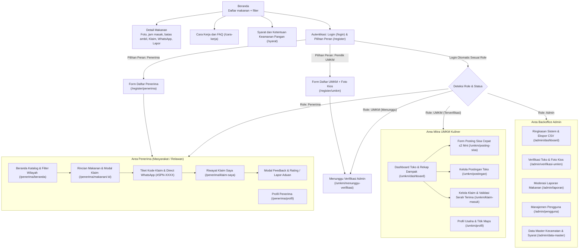

### 4.5 Status makanan dan klaim

**Status postingan (`food_posts.status`):**

| Status | Arti | Pemicu |
|---|---|---|
| `tersedia` | Masih ada kuota dan belum lewat batas ambil | Saat diposting |
| `habis_diklaim` | Seluruh kuota sudah diklaim | `porsi_tersisa = 0` |
| `selesai` | Semua klaim sudah diambil, atau UMKM menutup manual | Aksi UMKM / sistem |
| `kedaluwarsa` | Lewat batas ambil | Penjadwal otomatis |
| `ditangguhkan` | Disembunyikan sementara karena laporan | Aksi admin |

**Status klaim (`claims.status`):** `dipesan` → `diambil` (sukses), atau `batal` (dibatalkan penerima), atau `tidak_diambil` (lewat batas ambil).

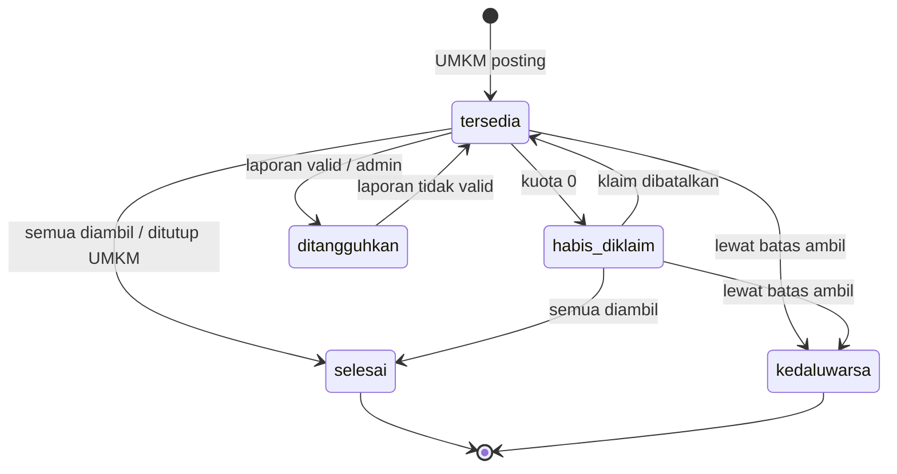

---

## 5. Fitur Berdasarkan Data Survei

### 5.1 Tabel penelusuran: fitur ← data survei

Prioritas: **MVP** = wajib selesai minggu 3; **MVP+** = dikerjakan jika waktu cukup; **Tahap 2** = pengembangan lanjutan (ditulis di naskah).

| ID | Fitur | Bukti dari survei | Aktor | Prioritas |
|---|---|---|---|---|
| F01 | **Registrasi dan login dengan 2 pilihan peran di awal (Penerima vs Pemilik UMKM)**, nomor WhatsApp wajib, antarmuka terpisah dinamis | 5/11 UMKM butuh penerima terverifikasi; 7/14 ingin semua terverifikasi | Semua | MVP |
| F02 | **Profil usaha dan verifikasi UMKM oleh admin** (nama usaha, jenis, alamat, kecamatan, WhatsApp usaha, foto usaha) | Jaminan nomor 1 masyarakat (7/14); saran "semua harus terverifikasi" | UMKM, Admin | MVP |
| F03 | **Posting sisa dagangan cepat**: foto, nama, jumlah, satuan, jam masak, batas ambil, peruntukan, kering/berkuah, info alergen | Fitur utama UMKM (7/11); foto jelas (3/14); jam masak (1/14); saran pisah kering/berkuah | UMKM | MVP |
| F04 | **Label peruntukan**: konsumsi manusia / pakan ternak / keduanya | 5/11 UMKM; 3/14 masyarakat akan memakai untuk pakan; 8/14 akan menyalurkan ulang | UMKM | MVP |
| F05 | **Beranda publik tanpa login**, daftar makanan tersedia | 11/14 belum tahu platform; kanal info sekarang acak | Pengunjung | MVP |
| F06 | **Pencarian dan filter**: kecamatan, peruntukan, kering/berkuah, urutan terbaru/segera habis | 2/14 meminta pencarian per kecamatan; 11/14 mau ≤1 km | Pengunjung, Penerima | MVP |
| F07 | **Detail makanan**: galeri foto, jam masak, batas ambil, kuota, lokasi, tautan Google Maps | 5/14 ragu soal keamanan; 3/14 butuh foto jelas | Pengunjung | MVP |
| F08 | **Klaim dengan kuota**: otomatis, maksimal per orang, kuota berkurang real-time | UMKM "repot mengurus" 3/11; keadilan distribusi | Penerima | MVP |
| F09 | **Tombol WhatsApp** (pesan otomatis ke UMKM setelah klaim) | Saran UMKM berulang: "link ke WA", "bisa chat ke WA" | Penerima | MVP |
| F10 | **Konfirmasi serah terima** ("Sudah diambil", "Tidak datang") | 5/11 UMKM; dasar rekap porsi terselamatkan | UMKM | MVP |
| F11 | **Syarat dan ketentuan + pernyataan keamanan pangan** (checklist UMKM saat posting, persetujuan penerima saat klaim, tercatat dengan versi) | 6/11 UMKM takut dituntut (skor kesediaan 2,67 vs 4,8) | UMKM, Penerima | MVP |
| F12 | **Status otomatis dan kedaluwarsa** | Keraguan basi 3/14; batas ambil jelas | Sistem | MVP |
| F13 | **Tombol lapor postingan** (basi, tidak sesuai foto, keluhan sakit, lainnya) + moderasi admin | Keamanan/kebersihan 5/14 ragu | Penerima, Admin | MVP |
| F14 | **Halaman Cara Kerja dan FAQ** (alur penerimaan dan penyaluran) | Saran UMKM: paparkan alur dan jalur; saran masyarakat: sosialisasi | Pengunjung | MVP |
| F15 | **Dashboard UMKM**: riwayat posting dan rekap porsi terselamatkan | 1/11 memilih riwayat/laporan, tetapi **dibutuhkan untuk indikator keberhasilan** dan insentif UMKM | UMKM | MVP |
| F16 | **Riwayat klaim penerima** | Transparansi dan kontrol penerima | Penerima | MVP |
| F17 | **Batas klaim per orang per hari** (anti penimbunan dan penjualan ulang) | Keadilan; kuota UMKM kecil (1-10 unit) | Sistem | MVP |
| F18 | **Privasi**: nomor WhatsApp penerima hanya terlihat UMKM yang bersangkutan setelah klaim | 2/14 ragu privasi; 2/14 malu mengambil gratis | Sistem | MVP |
| F19 | **Feedback singkat** setelah diambil (makanan sesuai? rating 1-5, komentar) | Dipakai di indikator kepuasan; belum dipilih responden sebagai jaminan utama | Penerima | MVP+ |
| F20 | **Rekap sistem admin** (jumlah UMKM aktif, porsi diambil, sebaran kecamatan, ekspor CSV) | Bahan data jurnal dan indikator | Admin | MVP+ |
| F21 | **Notifikasi** (klaim baru ke UMKM, pengingat batas ambil ke penerima) | Hanya 1/11 UMKM | Sistem | Tahap 2 |
| F22 | **Pendaftaran relawan penyalur** | 13/14 bersedia/mungkin | Penerima | Tahap 2 |
| F23 | **Pencarian radius jarak** (berdasarkan koordinat) | 11/14 ≤1 km; 6/14 <500 m | Penerima | Tahap 2 |
| F24 | **Rating UMKM dan lencana kepercayaan** | 0 responden memilihnya sebagai jaminan utama | Penerima | Tahap 2 |
| F25 | **Verifikasi nomor penerima dengan OTP** | Perkuat kepercayaan UMKM | Sistem | Tahap 2 |
| F26 | **Berbagi barang non-makanan** (sembako, pakaian, dll.) | Saran 1 responden | - | Di luar cakupan |

> **Catatan untuk laporan:** F19 (feedback) dan F24 (rating) berbeda. Untuk indikator "rating rata-rata ≥4/5", cukup pakai F19 (rating per transaksi). F24 (rating terakumulasi per UMKM) ditunda.

### 5.2 Fitur per aktor (ringkas)

| Aktor | Fitur MVP |
|---|---|
| **Pengunjung** | F05, F06, F07, F14, F11 (membaca syarat) |
| **Penerima** | F01, F08, F09, F13, F16, F18, F19 (MVP+) |
| **UMKM** | F01, F02, F03, F04, F10, F11, F15 |
| **Admin** | F02 (verifikasi), F13 (moderasi), data master, F20 (MVP+) |
| **Sistem** | F12, F17, F18 |

### 5.3 Field posting (hasil dari survei)

| Field | Wajib | Alasan dari data |
|---|---|---|
| Foto (1-4) | Ya, minimal 1 | Foto jelas dipilih 3/14; kunci kepercayaan |
| Nama makanan | Ya | Identifikasi |
| Jumlah dan satuan (porsi / pcs / bungkus / kotak) | Ya | Sisa 82% kue/roti, 1-10 unit |
| Jam masak/dibuat | Ya | Basi (3/14) dan keamanan (5/14) |
| Batas ambil | Ya | Basi dan keadilan; sisa 73% pasti sebelum 15.00 |
| Peruntukan (konsumsi / pakan / keduanya) | Ya | Pemanfaatan beragam |
| Tekstur (kering / berkuah) | Ya | Saran responden |
| Info alergen/bahan utama | Tidak | Keamanan |
| Maksimal porsi per klaim | Ya (default 2) | Keadilan kuota kecil |
| Cara penyimpanan saat ini | Tidak | Keamanan |
| Pernyataan keamanan (checklist) | Ya | 6/11 takut dituntut |

**Checklist pernyataan UMKM (contoh redaksi):**
- [ ] Makanan dibuat/dimasak hari ini dan belum pernah dijual ulang atau tersentuh pembeli.
- [ ] Makanan tidak berbau, berlendir, atau berjamur.
- [ ] Peruntukan dan jam masak yang saya isi sesuai kondisi sebenarnya.
- [ ] Saya telah membaca syarat dan ketentuan SIPANA.

**Pernyataan penerima saat klaim (contoh redaksi):**
- [ ] Saya memeriksa kondisi makanan saat mengambil dan memakainya sesuai peruntukan.
- [ ] Saya tidak akan menjual kembali makanan ini.
- [ ] Saya memahami SIPANA hanya menghubungkan, dan keputusan memakan ada pada saya.

> Catatan hukum: redaksi ini bersifat desain akademik. Untuk penerapan nyata, minta tinjauan ahli hukum atau dosen pembimbing.

---

## 6. Kebutuhan Fungsional dan Non-Fungsional

### 6.1 Kebutuhan fungsional

| ID | Kebutuhan | Fitur terkait |
|---|---|---|
| FR-01 | Sistem menyediakan registrasi dan login dengan peran penerima atau UMKM | F01 |
| FR-02 | UMKM dapat melengkapi profil usaha dan mengajukan verifikasi | F02 |
| FR-03 | Admin dapat menyetujui atau menolak pengajuan verifikasi UMKM dengan catatan | F02 |
| FR-04 | Hanya UMKM berstatus terverifikasi yang dapat membuat postingan | F02, F03 |
| FR-05 | UMKM dapat membuat postingan dengan field wajib pada bagian 5.3 | F03, F04 |
| FR-06 | Sistem menolak postingan tanpa foto, jam masak, batas ambil, atau checklist keamanan | F03, F11 |
| FR-07 | Pengunjung dapat melihat daftar dan detail makanan tanpa login | F05, F07 |
| FR-08 | Pengunjung dapat memfilter berdasarkan kecamatan, peruntukan, dan tekstur | F06 |
| FR-09 | Penerima dapat mengklaim jumlah tertentu dalam batas per klaim dan sisa kuota | F08 |
| FR-10 | Sistem mengurangi kuota secara atomik dan mencegah klaim melebihi kuota | F08 |
| FR-11 | Sistem mencatat persetujuan syarat beserta versinya saat klaim dan saat posting | F11 |
| FR-12 | Setelah klaim, sistem menampilkan tautan WhatsApp ke UMKM dengan pesan terisi otomatis | F09 |
| FR-13 | Penerima dapat membatalkan klaim sebelum batas ambil, kuota kembali | F08 |
| FR-14 | UMKM dapat menandai klaim "sudah diambil" atau "tidak datang" | F10 |
| FR-15 | Sistem mengubah status postingan menjadi kedaluwarsa setelah batas ambil | F12 |
| FR-16 | Penerima dapat melaporkan postingan dengan alasan; admin dapat menangguhkan | F13 |
| FR-17 | Sistem membatasi jumlah klaim aktif per penerima per hari | F17 |
| FR-18 | Sistem menyembunyikan nomor WhatsApp penerima dari pihak selain UMKM terkait | F18 |
| FR-19 | UMKM dapat melihat riwayat posting dan rekap porsi terselamatkan | F15 |
| FR-20 | Penerima dapat melihat riwayat klaim | F16 |
| FR-21 | Penerima dapat memberi rating dan komentar setelah klaim berstatus diambil | F19 |
| FR-22 | Admin dapat melihat rekap dan mengekspor data ke CSV | F20 |
| FR-23 | Sistem menyediakan halaman Cara Kerja, FAQ, serta Syarat dan Ketentuan | F14, F11 |

### 6.2 Kebutuhan non-fungsional

| ID | Kebutuhan | Dasar dari survei |
|---|---|---|
| NFR-01 | **Kemudahan:** UMKM dapat membuat postingan dalam ≤2 menit; target ≥80% UMKM menilai mudah | 7/11 UMKM bersyarat "tergantung kemudahan"; saran "mudah dipakai" |
| NFR-02 | **Responsif Landscape & Minimalis:** tampilan website landscape standar yang bersih, lega, dan modern pada layar desktop/laptop, serta adaptif responsif saat diakses dari tablet maupun smartphone | Kemudahan akses semua kalangan; saran "mudah dipakai" dan tampilan modern |
| NFR-03 | **Performa:** halaman beranda termuat ≤3 detik pada jaringan 4G; foto dikompres otomatis | Kuota data pengguna terbatas |
| NFR-04 | **Keamanan akun:** kata sandi di-hash (bcrypt/argon2), proteksi CSRF, validasi unggahan (tipe dan ukuran) | Standar |
| NFR-05 | **Privasi:** data pribadi minimal; nomor WhatsApp penerima tidak publik; kebijakan privasi sesuai prinsip UU PDP | 2/14 ragu privasi |
| NFR-06 | **Keandalan data klaim:** penguncian baris saat mengurangi kuota supaya tidak terjadi klaim ganda | Kuota kecil, rawan rebutan |
| NFR-07 | **Keterbacaan:** bahasa Indonesia sederhana, sapaan Akang/Teteh, tanpa istilah teknis | Target pengguna awam |
| NFR-08 | **Ketersediaan:** dapat diakses online (deploy) selama masa uji coba | Syarat uji SUS |
| NFR-09 | **Auditabilitas:** setiap perubahan status penting tercatat (waktu dan pelaku) | Bahan penelitian dan sengketa |
| NFR-10 | **Aksesibilitas dasar:** kontras warna cukup, label form jelas | Pengguna beragam usia |

---

## 7. Aturan Bisnis

| ID | Aturan |
|---|---|
| BR-01 | Hanya UMKM kuliner di Kabupaten Karawang yang boleh mendaftar sebagai pemberi. Kecamatan harus dipilih dari daftar resmi. |
| BR-02 | UMKM harus berstatus **terverifikasi** sebelum bisa memposting. Verifikasi manual oleh admin (cek foto usaha, alamat, kontak WhatsApp, atau akun media sosial usaha). |
| BR-03 | Makanan **selalu gratis**. Tidak ada kolom harga dan tidak ada pembayaran di sistem. |
| BR-04 | Setiap postingan wajib memuat minimal 1 foto, jam masak/dibuat, batas ambil, jumlah, satuan, peruntukan, dan tekstur. |
| BR-05 | Batas ambil harus **pada hari yang sama** dengan waktu posting dan paling lambat pukul 22.00. Jam masak tidak boleh di masa depan. |
| BR-06 | Makanan berlabel **pakan ternak** ditampilkan dengan penanda jelas "Bukan untuk dimakan manusia". Makanan berlabel konsumsi hanya boleh makanan yang masih layak. |
| BR-07 | Daftar makanan yang **tidak boleh** diposting: makanan basi/berjamur/berbau, makanan yang sudah pernah dijual ulang atau dibawa pulang pembeli, makanan mengandung alkohol, produk tanpa label yang tidak jelas asalnya. |
| BR-08 | Penerima hanya dapat memiliki **satu klaim aktif per postingan** dan maksimal **3 klaim aktif per hari** (angka dapat diubah admin). |
| BR-09 | Jumlah klaim per transaksi tidak boleh melebihi `maks_porsi_per_klaim` dan sisa kuota. |
| BR-10 | Penerima menyetujui syarat dan ketentuan versi terbaru setiap kali mengklaim. Persetujuan tercatat (waktu dan versi). |
| BR-11 | Penerima dilarang menjual kembali makanan. Pelanggaran dapat berujung blokir akun. |
| BR-12 | Klaim yang tidak diambil sampai batas ambil berstatus `tidak_diambil`. Penerima dengan ≥3 klaim tidak diambil dalam 30 hari dibatasi sementara (aturan anti-penimbunan). |
| BR-13 | Postingan dengan ≥2 laporan berbeda otomatis disembunyikan (`ditangguhkan`) sampai admin meninjau. Laporan "keluhan sakit" langsung diteruskan ke admin dan UMKM diberi tahu. |
| BR-14 | Nomor WhatsApp penerima hanya terlihat oleh UMKM yang postingannya diklaim, sampai batas ambil + 24 jam. |
| BR-15 | UMKM tidak boleh meminta imbalan dalam bentuk apa pun dari penerima atas makanan yang diposting. |
| BR-16 | Data rekap yang ditampilkan publik bersifat agregat (total porsi, jumlah UMKM), tanpa nama penerima. |

---

## 8. Use Case Diagram dan Spesifikasi

### 8.1 Daftar use case

| ID | Use Case | Aktor utama | Fitur |
|---|---|---|---|
| UC-01 | Melihat daftar makanan | Pengunjung | F05 |
| UC-02 | Mencari dan memfilter makanan | Pengunjung | F06 |
| UC-03 | Melihat detail makanan | Pengunjung | F07 |
| UC-04 | Membaca cara kerja dan syarat | Pengunjung | F14, F11 |
| UC-05 | Mendaftar akun | Pengunjung | F01 |
| UC-06 | Login dan logout | Penerima, UMKM, Admin | F01 |
| UC-07 | Mengklaim makanan | Penerima | F08 |
| UC-08 | Menghubungi UMKM via WhatsApp | Penerima | F09 |
| UC-09 | Membatalkan klaim | Penerima | F08 |
| UC-10 | Melihat riwayat klaim | Penerima | F16 |
| UC-11 | Melaporkan postingan | Penerima | F13 |
| UC-12 | Memberi feedback | Penerima | F19 |
| UC-13 | Melengkapi profil usaha dan mengajukan verifikasi | UMKM | F02 |
| UC-14 | Memposting sisa dagangan | UMKM | F03, F04, F11 |
| UC-15 | Mengelola postingan (ubah, tutup) | UMKM | F03 |
| UC-16 | Mengonfirmasi serah terima | UMKM | F10 |
| UC-17 | Melihat dashboard rekap | UMKM | F15 |
| UC-18 | Memverifikasi UMKM | Admin | F02 |
| UC-19 | Memoderasi laporan | Admin | F13 |
| UC-20 | Mengelola data master dan syarat | Admin | F11 |
| UC-21 | Melihat rekap sistem dan ekspor | Admin | F20 |
| UC-22 | Mengelola dan memblokir pengguna | Admin | BR-11, BR-12 |
| UC-23 | Menyetujui syarat dan pernyataan keamanan | (include) | F11 |
| UC-24 | Mengubah status kedaluwarsa otomatis | Sistem | F12 |
| UC-25 | Mengembalikan kuota otomatis | Sistem | F08, F12 |

### 8.2 Use case diagram

> **Gambar utama untuk laporan:** versi UML klasik (aktor stick figure, elips use case, kotak sistem, relasi include/extend) tersedia di file **`SIPANA_UseCase_Diagram.png`** (6020 × 4980 px) dan **`SIPANA_UseCase_Diagram.svg`** (vektor). Isinya sama dengan diagram Mermaid dan PlantUML di bawah.

Penerima, UMKM, dan Admin juga dapat melakukan semua use case milik Pengunjung (UC-01 sampai UC-04) setelah login.

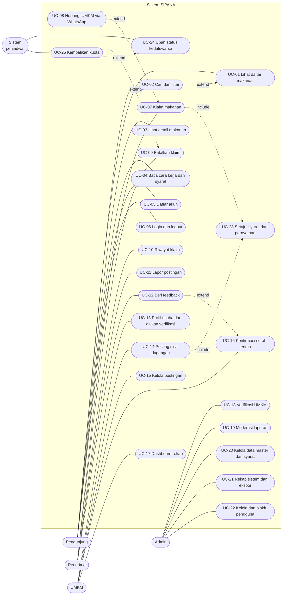

**Versi PlantUML** (notasi UML baku, untuk laporan; render di <https://www.plantuml.com/plantuml>):

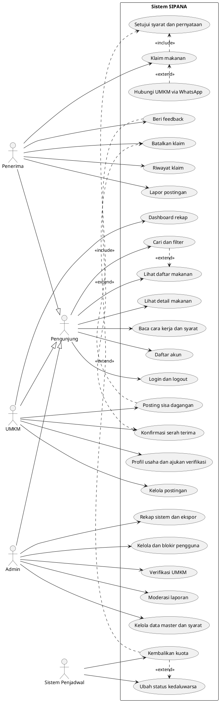

### 8.3 Spesifikasi use case utama

#### UC-14: Memposting sisa dagangan

| Item | Isi |
|---|---|
| **Aktor** | UMKM (terverifikasi) |
| **Tujuan** | Mengumumkan sisa dagangan supaya dapat diambil warga sebelum batas ambil |
| **Prakondisi** | UMKM sudah login dan status verifikasi = terverifikasi |
| **Pascakondisi** | Postingan berstatus `tersedia` dan tampil di beranda; persetujuan syarat tercatat |
| **Pemicu** | UMKM menekan tombol "Posting Sisa Dagangan" |

**Skenario normal**
1. UMKM membuka formulir posting. Sistem menampilkan formulir ringkas (target ≤2 menit).
2. UMKM mengunggah 1-4 foto.
3. UMKM mengisi nama, jumlah, satuan, jam masak, batas ambil, peruntukan, dan tekstur (kering/berkuah). Info alergen dan penyimpanan opsional.
4. UMKM mencentang pernyataan keamanan (UC-23).
5. UMKM menekan "Terbitkan".
6. Sistem memvalidasi data (BR-04, BR-05), menyimpan postingan, mengisi `porsi_tersisa = jumlah`, dan menampilkannya di beranda.

**Skenario alternatif / pengecualian**
- 3a. UMKM belum terverifikasi: sistem menolak dan mengarahkan ke UC-13.
- 6a. Data tidak valid (foto kosong, jam masak di masa depan, batas ambil lewat): sistem menampilkan pesan per kolom, data yang sudah diisi tidak hilang.
- 4a. Checklist tidak dicentang: tombol "Terbitkan" nonaktif.

#### UC-07: Mengklaim makanan

| Item | Isi |
|---|---|
| **Aktor** | Penerima |
| **Tujuan** | Memesan sejumlah makanan untuk diambil |
| **Prakondisi** | Penerima sudah login; postingan `tersedia`, belum lewat batas ambil, kuota > 0 |
| **Pascakondisi** | Klaim berstatus `dipesan`, kuota berkurang, tombol WhatsApp muncul |
| **Include** | UC-23 (setujui syarat dan pernyataan) |
| **Extend** | UC-08 (hubungi UMKM via WhatsApp) |

**Skenario normal**
1. Penerima membuka detail makanan (UC-03) dan menekan "Klaim".
2. Sistem menampilkan pilihan jumlah (maksimal sesuai BR-09) dan pernyataan penerima.
3. Penerima memilih jumlah, mencentang pernyataan, lalu menekan "Konfirmasi Klaim".
4. Sistem memeriksa kuota secara atomik, membuat klaim, mengurangi `porsi_tersisa`, dan menyimpan persetujuan beserta versi syarat.
5. Sistem menampilkan halaman konfirmasi: alamat, batas ambil, dan tombol "Hubungi UMKM via WhatsApp" (pesan sudah terisi).

**Skenario alternatif / pengecualian**
- 1a. Belum login: sistem mengarahkan ke UC-06/UC-05, setelah itu kembali ke detail yang sama.
- 4a. Kuota sudah habis (diklaim orang lain pada saat yang sama): sistem menolak dengan pesan ramah dan menawarkan makanan lain.
- 4b. Penerima melewati batas klaim aktif per hari (BR-08): sistem menolak dan menjelaskan aturan.
- 4c. Penerima dibatasi sementara (BR-12): sistem menampilkan alasan dan tanggal berakhir.

#### UC-16: Mengonfirmasi serah terima

| Item | Isi |
|---|---|
| **Aktor** | UMKM |
| **Tujuan** | Mencatat bahwa makanan sudah diambil (atau tidak diambil) |
| **Prakondisi** | Ada klaim berstatus `dipesan` pada postingan UMKM |
| **Pascakondisi** | Klaim `diambil` atau `tidak_diambil`; rekap porsi terselamatkan bertambah |

**Skenario normal**
1. UMKM membuka "Kelola Klaim" dan melihat daftar klaim aktif (nama, jumlah, nomor WhatsApp).
2. Penerima datang. UMKM menekan "Sudah diambil".
3. Sistem mengubah status klaim, mencatat `picked_up_at`, dan memperbarui rekap.
4. Jika semua klaim diambil, postingan menjadi `selesai`.
5. Sistem membuka kesempatan feedback bagi penerima (UC-12).

**Alternatif:** 2a. Penerima tidak datang sampai batas ambil: UMKM menekan "Tidak datang" atau sistem otomatis menandai `tidak_diambil` (UC-24).

#### UC-18: Memverifikasi UMKM

| Item | Isi |
|---|---|
| **Aktor** | Admin |
| **Prakondisi** | Ada pengajuan berstatus `menunggu` |
| **Pascakondisi** | Status `terverifikasi` atau `ditolak` beserta catatan |

**Skenario normal**
1. Admin membuka antrean verifikasi dan memilih satu pengajuan.
2. Admin memeriksa data usaha (foto, alamat, kecamatan, WhatsApp, tautan media sosial/foto lapak) dan boleh menghubungi UMKM.
3. Admin memilih "Setujui" atau "Tolak" dan mengisi catatan.
4. Sistem memperbarui status, mencatat `verified_by` dan `verified_at`, lalu mengirim pemberitahuan (tahap 1: tampil di dashboard UMKM).

#### UC-11 dan UC-19: Lapor dan moderasi

| Item | Isi |
|---|---|
| **Aktor** | Penerima (melapor), Admin (moderasi) |
| **Skenario normal** | Penerima menekan "Lapor" pada detail makanan, memilih alasan (basi, tidak sesuai foto, keluhan sakit, lainnya) dan menulis deskripsi singkat. Sistem menyimpan laporan. Admin meninjau, memilih "Valid" (postingan ditangguhkan, UMKM diberi peringatan) atau "Tidak valid" (postingan aktif kembali). |
| **Aturan** | BR-13: ≥2 laporan berbeda otomatis menangguhkan postingan sementara. |

### 8.4 Ringkasan use case lainnya

| UC | Prakondisi | Hasil | Pengecualian utama |
|---|---|---|---|
| UC-01 Lihat daftar | - | Daftar postingan `tersedia` terbaru | Tidak ada postingan: tampil pesan kosong + ajakan ke halaman Cara Kerja |
| UC-02 Cari/filter | - | Daftar tersaring (kecamatan, peruntukan, tekstur) | Hasil kosong: tawarkan hapus filter |
| UC-03 Detail | Postingan ada | Info lengkap + tombol Klaim/Lapor | Postingan sudah kedaluwarsa: tampil status, tombol klaim nonaktif |
| UC-05 Daftar | - | Akun baru aktif | Email/nomor WhatsApp sudah terdaftar |
| UC-09 Batalkan klaim | Klaim `dipesan`, belum lewat batas ambil | Klaim `batal`, kuota kembali (UC-25) | Sudah lewat batas ambil: tidak dapat dibatalkan |
| UC-12 Feedback | Klaim `diambil` | Rating dan komentar tersimpan | Sudah pernah memberi feedback untuk klaim itu |
| UC-13 Profil usaha | Akun UMKM | Pengajuan `menunggu` | Data wajib kurang |
| UC-15 Kelola postingan | Postingan milik UMKM | Ubah/tutup postingan | Ubah jumlah di bawah total yang sudah diklaim: ditolak |
| UC-17 Dashboard | UMKM login | Total posting, porsi diambil, tingkat terambil | Belum ada data: tampil kosong |
| UC-20 Data master | Admin | Kecamatan, kategori, syarat versi baru | Versi syarat baru tidak berlaku surut |
| UC-21 Rekap | Admin | Statistik dan CSV | - |
| UC-22 Blokir | Admin | Akun `diblokir` | - |
| UC-24 Kedaluwarsa | Penjadwal berjalan (cron/scheduler tiap 5-15 menit) | Status diperbarui | Gagal jalan: status dihitung ulang saat halaman dimuat (cadangan) |

---

## 9. Activity Diagram

Setiap diagram memakai *swimlane* (subgraph per pelaku). Simbol: `([ ])` = awal/akhir, `[ ]` = aktivitas, `{ }` = keputusan.

### 9.1 AD-01: Registrasi 2 Peran dan Verifikasi UMKM

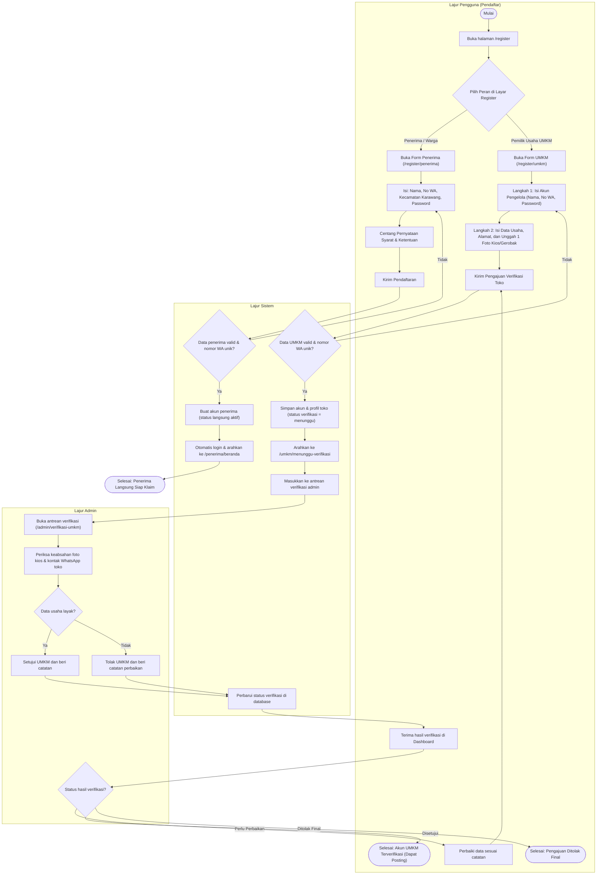

### 9.2 AD-02: Memposting sisa dagangan

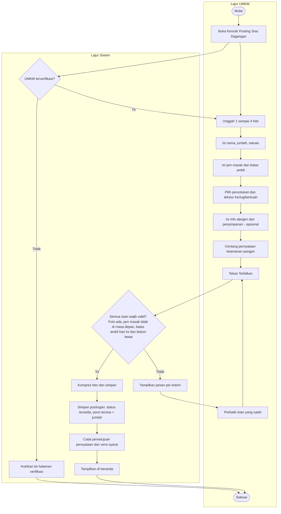

### 9.3 AD-03: Mencari, mengklaim, dan mengambil makanan

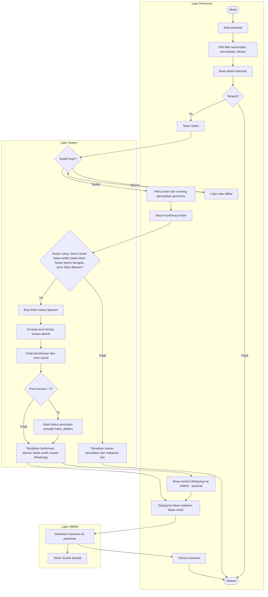

### 9.4 AD-04: Konfirmasi serah terima dan feedback

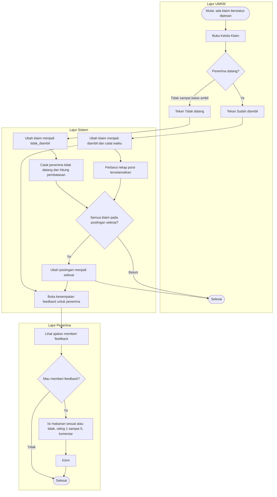

### 9.5 AD-05: Lapor dan moderasi postingan

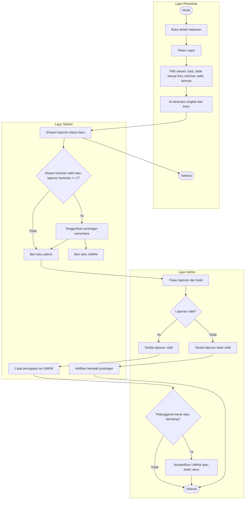

### 9.6 AD-06: Penutupan otomatis (kedaluwarsa)

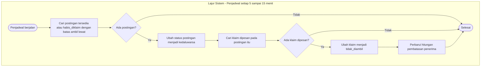

---

## 10. ERD (Entity Relationship Diagram)

### 10.1 Diagram

Entitas bertanda **(tahap 2)** disertakan di desain supaya tabel tidak perlu dirombak, tetapi tidak wajib dibuat di MVP.

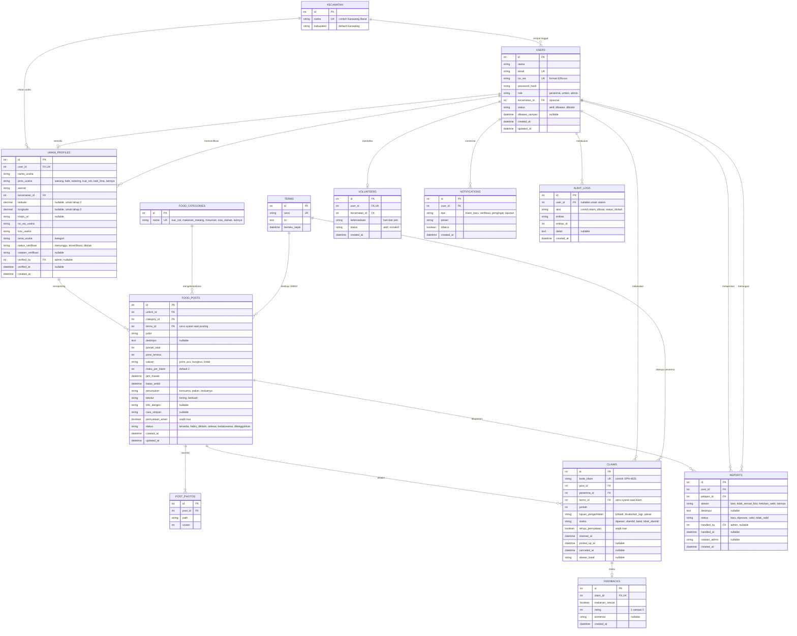

**Keterangan:** `VOLUNTEERS` dan `NOTIFICATIONS` adalah **tahap 2**. `AUDIT_LOGS` dapat dibuat sederhana di MVP (cukup mencatat perubahan status penting) untuk memenuhi NFR-09.

### 10.2 Daftar relasi

| Relasi | Kardinalitas | Penjelasan |
|---|---|---|
| KECAMATAN → USERS | 1 : N | Satu kecamatan dihuni banyak pengguna. Kolom `kecamatan_id` opsional |
| KECAMATAN → UMKM_PROFILES | 1 : N | Satu kecamatan memiliki banyak UMKM |
| USERS → UMKM_PROFILES | 1 : 0..1 | Hanya akun berperan `umkm` yang memiliki profil usaha |
| USERS (admin) → UMKM_PROFILES | 1 : N | Admin memverifikasi banyak UMKM (`verified_by`) |
| UMKM_PROFILES → FOOD_POSTS | 1 : N | Satu UMKM membuat banyak postingan |
| FOOD_CATEGORIES → FOOD_POSTS | 1 : N | Satu kategori memiliki banyak postingan |
| FOOD_POSTS → POST_PHOTOS | 1 : 1..N | Postingan wajib memiliki minimal satu foto (BR-04) |
| FOOD_POSTS → CLAIMS | 1 : N | Satu postingan dapat diklaim banyak penerima sampai kuota habis |
| USERS (penerima) → CLAIMS | 1 : N | Satu penerima dapat memiliki banyak klaim |
| CLAIMS → FEEDBACKS | 1 : 0..1 | Satu klaim berstatus `diambil` maksimal satu feedback |
| FOOD_POSTS → REPORTS | 1 : N | Satu postingan dapat dilaporkan beberapa kali |
| USERS → REPORTS | 1 : N (pelapor) dan 1 : N (penangan) | Dua relasi berbeda ke tabel yang sama |
| TERMS → FOOD_POSTS dan CLAIMS | 1 : N | Mengunci versi syarat yang disetujui saat itu |

### 10.3 Kendala data (constraint) penting

| Kendala | Tujuan |
|---|---|
| `UNIQUE(users.email)`, `UNIQUE(users.no_wa)` | Mencegah akun ganda (FR-17, BR-08) |
| `UNIQUE(umkm_profiles.user_id)` | Satu akun UMKM, satu profil usaha |
| `UNIQUE(feedbacks.claim_id)` | Satu feedback per klaim |
| `CHECK(food_posts.porsi_tersisa BETWEEN 0 AND jumlah_total)` | Kuota tidak negatif/berlebih |
| `CHECK(claims.jumlah >= 1)` dan jumlah ≤ `maks_per_klaim` (validasi aplikasi) | BR-09 |
| `CHECK(feedbacks.rating BETWEEN 1 AND 5)` | Skala valid |
| `food_posts.batas_ambil > food_posts.jam_masak` | Logika waktu (BR-05) |
| Satu klaim aktif per (post, penerima): unik pada `post_id, penerima_id` untuk status `dipesan` | BR-08 |
| `FOREIGN KEY ... ON DELETE RESTRICT` pada klaim dan postingan | Riwayat tidak hilang saat data induk dihapus; gunakan status, bukan hapus |

### 10.4 Mengatasi klaim bersamaan (race condition)

Karena kuota kecil dan banyak orang bisa menekan "Klaim" bersamaan, pengurangan kuota harus atomik:

```sql
-- Dalam satu transaksi
UPDATE food_posts
SET porsi_tersisa = porsi_tersisa - :jumlah
WHERE id = :post_id
  AND status = 'tersedia'
  AND batas_ambil > NOW()
  AND porsi_tersisa >= :jumlah;
-- Jika baris terpengaruh = 0 -> klaim ditolak (kuota habis atau sudah lewat)
-- Jika = 1 -> INSERT klaim, lalu set status 'habis_diklaim' bila porsi_tersisa = 0
```

---

## 11. Skrip Database (SQL)

Skrip untuk **MySQL 8 / MariaDB**. Untuk PostgreSQL ganti `AUTO_INCREMENT` dengan `GENERATED ALWAYS AS IDENTITY` dan `ENUM` dengan tipe `CREATE TYPE` atau `CHECK`. Jika memakai Laravel atau Prisma, skrip ini dapat dijadikan acuan migrasi.

```sql
CREATE TABLE kecamatan (
  id INT AUTO_INCREMENT PRIMARY KEY,
  nama VARCHAR(80) NOT NULL UNIQUE,
  kabupaten VARCHAR(80) NOT NULL DEFAULT 'Karawang'
);

CREATE TABLE terms (
  id INT AUTO_INCREMENT PRIMARY KEY,
  versi VARCHAR(20) NOT NULL UNIQUE,
  isi TEXT NOT NULL,
  berlaku_sejak DATETIME NOT NULL
);

CREATE TABLE users (
  id INT AUTO_INCREMENT PRIMARY KEY,
  nama VARCHAR(120) NOT NULL,
  email VARCHAR(160) NOT NULL UNIQUE,
  no_wa VARCHAR(20) NOT NULL UNIQUE,
  password_hash VARCHAR(255) NOT NULL,
  role ENUM('penerima','umkm','admin') NOT NULL,
  kecamatan_id INT NULL,
  status ENUM('aktif','dibatasi','diblokir') NOT NULL DEFAULT 'aktif',
  dibatasi_sampai DATETIME NULL,
  created_at DATETIME NOT NULL DEFAULT CURRENT_TIMESTAMP,
  updated_at DATETIME NOT NULL DEFAULT CURRENT_TIMESTAMP ON UPDATE CURRENT_TIMESTAMP,
  FOREIGN KEY (kecamatan_id) REFERENCES kecamatan(id)
);

CREATE TABLE umkm_profiles (
  id INT AUTO_INCREMENT PRIMARY KEY,
  user_id INT NOT NULL UNIQUE,
  nama_usaha VARCHAR(160) NOT NULL,
  jenis_usaha ENUM('warung','kafe','katering','kue_roti','kaki_lima','lainnya') NOT NULL,
  alamat VARCHAR(255) NOT NULL,
  kecamatan_id INT NOT NULL,
  latitude DECIMAL(10,7) NULL,
  longitude DECIMAL(10,7) NULL,
  maps_url VARCHAR(255) NULL,
  no_wa_usaha VARCHAR(20) NOT NULL,
  foto_usaha VARCHAR(255) NULL,
  lama_usaha ENUM('<1','1-3','3-5','>5') NULL,
  status_verifikasi ENUM('menunggu','terverifikasi','ditolak') NOT NULL DEFAULT 'menunggu',
  catatan_verifikasi VARCHAR(255) NULL,
  verified_by INT NULL,
  verified_at DATETIME NULL,
  created_at DATETIME NOT NULL DEFAULT CURRENT_TIMESTAMP,
  FOREIGN KEY (user_id) REFERENCES users(id),
  FOREIGN KEY (kecamatan_id) REFERENCES kecamatan(id),
  FOREIGN KEY (verified_by) REFERENCES users(id)
);

CREATE TABLE food_categories (
  id INT AUTO_INCREMENT PRIMARY KEY,
  nama VARCHAR(60) NOT NULL UNIQUE
);

CREATE TABLE food_posts (
  id INT AUTO_INCREMENT PRIMARY KEY,
  umkm_id INT NOT NULL,
  category_id INT NOT NULL,
  terms_id INT NOT NULL,
  judul VARCHAR(160) NOT NULL,
  deskripsi TEXT NULL,
  jumlah_total INT NOT NULL,
  porsi_tersisa INT NOT NULL,
  satuan ENUM('porsi','pcs','bungkus','kotak') NOT NULL DEFAULT 'porsi',
  maks_per_klaim INT NOT NULL DEFAULT 2,
  jam_masak DATETIME NOT NULL,
  batas_ambil DATETIME NOT NULL,
  peruntukan ENUM('konsumsi','pakan','keduanya') NOT NULL,
  tekstur ENUM('kering','berkuah') NOT NULL,
  info_alergen VARCHAR(200) NULL,
  cara_simpan VARCHAR(200) NULL,
  pernyataan_aman TINYINT(1) NOT NULL DEFAULT 0,
  status ENUM('tersedia','habis_diklaim','selesai','kedaluwarsa','ditangguhkan') NOT NULL DEFAULT 'tersedia',
  created_at DATETIME NOT NULL DEFAULT CURRENT_TIMESTAMP,
  updated_at DATETIME NOT NULL DEFAULT CURRENT_TIMESTAMP ON UPDATE CURRENT_TIMESTAMP,
  FOREIGN KEY (umkm_id) REFERENCES umkm_profiles(id),
  FOREIGN KEY (category_id) REFERENCES food_categories(id),
  FOREIGN KEY (terms_id) REFERENCES terms(id),
  CHECK (jumlah_total >= 1),
  CHECK (porsi_tersisa >= 0 AND porsi_tersisa <= jumlah_total),
  CHECK (batas_ambil > jam_masak),
  CHECK (pernyataan_aman = 1),
  INDEX idx_posts_status_batas (status, batas_ambil),
  INDEX idx_posts_umkm (umkm_id)
);

CREATE TABLE post_photos (
  id INT AUTO_INCREMENT PRIMARY KEY,
  post_id INT NOT NULL,
  path VARCHAR(255) NOT NULL,
  urutan INT NOT NULL DEFAULT 1,
  FOREIGN KEY (post_id) REFERENCES food_posts(id) ON DELETE CASCADE
);

CREATE TABLE claims (
  id INT AUTO_INCREMENT PRIMARY KEY,
  kode_klaim VARCHAR(12) NOT NULL UNIQUE,
  post_id INT NOT NULL,
  penerima_id INT NOT NULL,
  terms_id INT NOT NULL,
  jumlah INT NOT NULL,
  tujuan_pengambilan ENUM('pribadi','disalurkan_lagi','pakan') NOT NULL DEFAULT 'pribadi',
  status ENUM('dipesan','diambil','batal','tidak_diambil') NOT NULL DEFAULT 'dipesan',
  setuju_pernyataan TINYINT(1) NOT NULL DEFAULT 0,
  claimed_at DATETIME NOT NULL DEFAULT CURRENT_TIMESTAMP,
  picked_up_at DATETIME NULL,
  canceled_at DATETIME NULL,
  alasan_batal VARCHAR(200) NULL,
  FOREIGN KEY (post_id) REFERENCES food_posts(id),
  FOREIGN KEY (penerima_id) REFERENCES users(id),
  FOREIGN KEY (terms_id) REFERENCES terms(id),
  CHECK (jumlah >= 1),
  CHECK (setuju_pernyataan = 1),
  INDEX idx_claims_post (post_id, status),
  INDEX idx_claims_penerima (penerima_id, claimed_at),
  INDEX idx_claims_kode (kode_klaim)
);

CREATE TABLE feedbacks (
  id INT AUTO_INCREMENT PRIMARY KEY,
  claim_id INT NOT NULL UNIQUE,
  makanan_sesuai TINYINT(1) NOT NULL,
  rating TINYINT NOT NULL,
  komentar VARCHAR(255) NULL,
  created_at DATETIME NOT NULL DEFAULT CURRENT_TIMESTAMP,
  FOREIGN KEY (claim_id) REFERENCES claims(id),
  CHECK (rating BETWEEN 1 AND 5)
);

CREATE TABLE reports (
  id INT AUTO_INCREMENT PRIMARY KEY,
  post_id INT NOT NULL,
  pelapor_id INT NOT NULL,
  alasan ENUM('basi','tidak_sesuai_foto','keluhan_sakit','lainnya') NOT NULL,
  deskripsi TEXT NULL,
  status ENUM('baru','diproses','valid','tidak_valid') NOT NULL DEFAULT 'baru',
  handled_by INT NULL,
  handled_at DATETIME NULL,
  catatan_admin VARCHAR(255) NULL,
  created_at DATETIME NOT NULL DEFAULT CURRENT_TIMESTAMP,
  FOREIGN KEY (post_id) REFERENCES food_posts(id),
  FOREIGN KEY (pelapor_id) REFERENCES users(id),
  FOREIGN KEY (handled_by) REFERENCES users(id),
  INDEX idx_reports_post (post_id, status)
);

-- Tahap 2
CREATE TABLE volunteers (
  id INT AUTO_INCREMENT PRIMARY KEY,
  user_id INT NOT NULL UNIQUE,
  kecamatan_id INT NOT NULL,
  ketersediaan VARCHAR(160) NULL,
  status ENUM('aktif','nonaktif') NOT NULL DEFAULT 'aktif',
  created_at DATETIME NOT NULL DEFAULT CURRENT_TIMESTAMP,
  FOREIGN KEY (user_id) REFERENCES users(id),
  FOREIGN KEY (kecamatan_id) REFERENCES kecamatan(id)
);

CREATE TABLE notifications (
  id INT AUTO_INCREMENT PRIMARY KEY,
  user_id INT NOT NULL,
  tipe ENUM('klaim_baru','verifikasi','pengingat','laporan') NOT NULL,
  pesan VARCHAR(255) NOT NULL,
  dibaca TINYINT(1) NOT NULL DEFAULT 0,
  created_at DATETIME NOT NULL DEFAULT CURRENT_TIMESTAMP,
  FOREIGN KEY (user_id) REFERENCES users(id)
);

CREATE TABLE audit_logs (
  id INT AUTO_INCREMENT PRIMARY KEY,
  user_id INT NULL,
  aksi VARCHAR(60) NOT NULL,
  entitas VARCHAR(40) NOT NULL,
  entitas_id INT NOT NULL,
  detail TEXT NULL,
  created_at DATETIME NOT NULL DEFAULT CURRENT_TIMESTAMP,
  FOREIGN KEY (user_id) REFERENCES users(id)
);
```

> Catatan: `CHECK (pernyataan_aman = 1)` dan `CHECK (setuju_pernyataan = 1)` memastikan postingan dan klaim tidak dapat tersimpan tanpa persetujuan. MySQL 8.0.16+ menjalankan constraint CHECK; MariaDB 10.2+ juga.

**Data awal (seed) yang perlu disiapkan:** daftar kecamatan Karawang lengkap (cek situs resmi Pemkab Karawang), kategori makanan, satu versi syarat dan ketentuan, satu akun admin.

---

## 12. Rancangan Antarmuka & Design System

> **Status sistem visual (8 November 2026):** Direction yang berlaku adalah **Jaringan Pangan Lokal** dengan palet hijau-forward. Spesifikasi logo, token, tipografi, komponen, dan status migrasi terbaru ada di [`brand-identity-guidelines.md`](brand-identity-guidelines.md), [`design-system-migration-status.md`](design-system-migration-status.md), serta dokumen native [`sipana-complete-ui.figcraft`](sipana-complete-ui.figcraft). Rincian warna Soft Sky Blue, Deep Marine Navy sebagai warna antarmuka, Plus Jakarta Sans, Quicksand, contoh kode, dan resep layar lama di §12.1–12.9 adalah materi historis, bukan spesifikasi visual aktif. Gunakan PRD sebagai sumber utama untuk perilaku produk; contoh historis tidak mengesahkan fitur yang belum didukung PRD.

### 12.1 Filosofi Desain & Karakter Visual

Antarmuka SIPANA mengusung estetika **Clean Modern Minimalist Landscape Web**:
- **Standard Landscape Web Layout (Desktop-First & Fluid Responsive)**:
  Situs web dirancang dengan tata letak horizontal standar (*landscape*) yang memanfaatkan lebar layar desktop/laptop secara optimal (`max-w-7xl` atau `1280px`). Antarmuka terasa lega (*breathable & spacious*), terstruktur rapi dengan bilah navigasi horizontal di bagian atas (*top navbar*), hero banner pencarian terpadu, dan katalog grid multi-kolom yang adaptif:
  - Layar Desktop/Laptop (≥1024px): Grid 3 atau 4 kolom kartu makanan.
  - Layar Tablet (768px – 1023px): Grid 2 kolom kartu makanan.
  - Layar Ponsel (<768px): Grid 1 kolom vertikal yang nyaman diakses satu tangan.
- **Prinsip Minimalis & Ramah Lansia/Orang Tua**:
  - *Bebas Elemen Bertumpuk*: Menghilangkan elemen visual yang membingungkan. Tombol navigasi dan aksi berukuran besar dan jelas.
  - *Ruang Bernapas (White Space)*: Menggunakan jarak antar-elemen yang lega sehingga teks nama makanan, alamat toko, dan sisa porsi sangat mudah dibaca oleh pedagang UMKM dan warga usia 40–60 tahun.
- **Warm, Respectful & Dignified Tone**: Menggunakan bahasa yang santun dan hangat dengan sapaan khas Sunda/Karawang **Akang/Teteh**. Menghindari diksi yang merendahkan, diganti dengan istilah bermartabat seperti **"Penyelamat Pangan"**, **"Ambil Makanan"**, dan **"Salurkan Berkah"**.
- **Subtle Modern Micro-interactions**: Efek transisi halus (`transition-all duration-200`), efek *lift-up card* saat kursor diarahkan (*hover: -translate-y-1*), dan feedback sentuhan taktil (`active:scale-[0.98]`).

---

### 12.2 Sistem Warna & Desain Aksesibilitas (WCAG AAA)

Warna identitas utama SIPANA adalah **Soft Sky Blue (`#AEDAEF`)** yang melambangkan kebersihan, higienitas pangan, ketenangan, dan keterbukaan sosial. 

> **Prinsip Aksesibilitas untuk Orang Tua / Lansia (UMKM & Masyarakat):**  
> Mengingat banyak pemilik UMKM kuliner dan penerima manfaat berada pada rentang usia 40–60 tahun, keterbacaan (*readability*) adalah prioritas mutlak. Karena `#AEDAEF` adalah warna pastel terang (*high luminance*), **DILARANG meletakkan teks putih (`#FFFFFF`) di atas `#AEDAEF`** karena tidak terbaca. Pasangan teks wajib menggunakan warna kontras pekat **Deep Marine Navy (`#0F2840`)** yang menghasilkan rasio kontras **11.5:1 (Lolos Standar Tertinggi WCAG AAA)**.

```
┌─────────────────────────────────────────────────────────────────────────────────┐
│                           PALET WARNA RESMI SIPANA                              │
├──────────────────────┬─────────────┬────────────────────────────────────────────┤
│ Peran Warna          │ Kode Hex    │ Fungsi & Penerapan                         │
├──────────────────────┼─────────────┼────────────────────────────────────────────┤
│ 1. Brand Soft Accent │ #AEDAEF     │ Warna identitas, badge, border focus, tint │
│ 2. Deep Marine Navy  │ #0F2840     │ Teks utama, judul, dan Tombol CTA Utama    │
│ 3. Fresh Card Surface│ #FFFFFF     │ Background kartu makanan & input formulir  │
│ 4. Canvas Background │ #F8FAFC     │ Latar seluruh halaman website (segar/bersih│
│ 5. Warm Tangerine    │ #FA8C16     │ Urgensi batas ambil ("Sisa 1 Jam!", kuota) │
│ 6. Halal/Fresh Green │ #10B981     │ Status badge "Tersedia" & "Terverifikasi"  │
│ 7. Muted Border      │ #E2E8F0     │ Garis pembatas kartu & form input          │
└──────────────────────┴─────────────┴────────────────────────────────────────────┘
```

#### Aturan Penggunaan Status & Badge:
- **Tersedia / Terverifikasi**: Background `bg-emerald-50 text-emerald-700 border-emerald-200` dengan ikon `CheckCircle2` / `ShieldCheck`.
- **Mendesak / Segera Berakhir (<2 Jam)**: Background `bg-amber-50 text-amber-700 border-amber-200` dengan ikon `Clock` / `Flame`.
- **Habis / Kedaluwarsa**: Background `bg-gray-100 text-gray-500 border-gray-200` dengan ikon `AlertCircle`.
- **Peruntukan Pakan Ternak**: Background `bg-purple-50 text-purple-700 border-purple-200` dengan penanda tegas `Bukan untuk Konsumsi Manusia`.

---

### 12.3 Sistem Tipografi & Font Hierarchy

Aplikasi memadukan Google Fonts modern yang ramah dan memiliki tingkat keterbacaan tinggi di berbagai resolusi layar:
1. **Plus Jakarta Sans** (Heading, Judul Kartu, Tombol, Label Input, Display) — Modern, geometris, tegas, dan mudah dibaca oleh mata orang tua.
2. **Quicksand** (Subtitle sambutan, aksen ramah, teks edukasi) — Rounded, hangat, dan bersahabat.
3. **system-ui** (Label kecil, Badge status, Captions navbar) — Mengoptimalkan ketajaman teks berukuran < 12px.

```html
<!-- Impor Google Fonts di index.html / layout -->
<link rel="preconnect" href="https://fonts.googleapis.com">
<link rel="preconnect" href="https://fonts.gstatic.com" crossorigin>
<link href="https://fonts.googleapis.com/css2?family=Plus+Jakarta+Sans:wght@400;500;600;700;800;900&family=Quicksand:wght@500;600;700&display=swap" rel="stylesheet">
```

#### Skala Hirarki Tipografi:
- **Hero Title (H1 Desktop)**: `text-4xl lg:text-5xl font-black text-[#0F2840] leading-tight`
- **Section Heading (H2)**: `text-2xl font-extrabold text-[#0F2840]`
- **Card Title (Nama Makanan)**: `text-lg font-bold text-[#0F2840] line-clamp-1`
- **Body Regular (Keterangan)**: `text-sm sm:text-base text-gray-600 font-normal leading-relaxed`
- **Kode Klaim Khusus**: `text-3xl font-black tracking-wider text-[#0F2840]`
- **Meta / Timestamp / Countdown**: `text-xs font-semibold text-gray-500`
- **Micro Label / Badge**: `text-[11px] font-bold uppercase tracking-wider`

---

### 12.4 Konfigurasi Tailwind CSS v4 (`index.css`)

Sesuai standar Tailwind CSS v4, styling didefinisikan menggunakan direktif `@theme` dan utilities modern untuk website landscape responsif:

```css
@import "tailwindcss";

html,
body,
#root {
    background-color: #F8FAFC; /* Canvas Web Bersih & Sejuk */
    font-family: "Plus Jakarta Sans", sans-serif;
    color: #0F2840;
    min-height: 100vh;
}

@theme {
    --font-jakarta   : "Plus Jakarta Sans", sans-serif;
    --font-quicksand : "Quicksand", sans-serif;
    --font-system-ui : system-ui, sans-serif;

    /* Semantic Tokens SIPANA */
    --color-sipana-primary   : #AEDAEF; /* Soft Sky Blue */
    --color-sipana-dark      : #0F2840; /* Deep Marine Navy */
    --color-sipana-surface   : #FFFFFF; /* Pure White Card */
    --color-sipana-bg        : #F8FAFC; /* Full Web Canvas */
    --color-sipana-orange    : #FA8C16; /* Urgensi Jam & Porsi */
    --color-sipana-green     : #10B981; /* Status Aman/Layak */
    --color-sipana-border    : #E2E8F0; /* Border Halus */
}

@layer utilities {
    .font-jakarta   { font-family: var(--font-jakarta); }
    .font-quicksand { font-family: var(--font-quicksand); }
    .font-system-ui { font-family: var(--font-system-ui); }

    /* Kontainer Web Landscape Standar (Maksimal 1280px di Tengah Layar) */
    .web-container {
        max-width: 80rem; /* 1280px */
        margin-left: auto;
        margin-right: auto;
        padding-left: 1.5rem;
        padding-right: 1.5rem;
    }

    /* Grid Kartu Makanan Responsif (1 Kolom HP, 2 Kolom Tablet, 3-4 Kolom Desktop) */
    .food-grid {
        display: grid;
        grid-template-columns: repeat(1, minmax(0, 1fr));
        gap: 1.5rem;
    }
    @media (min-width: 640px) {
        .food-grid { grid-template-columns: repeat(2, minmax(0, 1fr)); }
    }
    @media (min-width: 1024px) {
        .food-grid { grid-template-columns: repeat(3, minmax(0, 1fr)); }
    }
    @media (min-width: 1280px) {
        .food-grid { grid-template-columns: repeat(4, minmax(0, 1fr)); }
    }

    /* Kartu Makanan Bersih dengan Efek Angkat Halus */
    .sipana-card {
        background-color: #FFFFFF;
        border: 1px solid #E2E8F0;
        border-radius: 1rem;
        box-shadow: 0 2px 8px rgba(15, 40, 64, 0.04);
        transition: transform 0.2s ease, box-shadow 0.2s ease;
    }
    .sipana-card:hover {
        transform: translateY(-4px);
        box-shadow: 0 12px 24px rgba(15, 40, 64, 0.08);
        border-color: #AEDAEF;
    }
}
```

---

### 12.5 Pola Navigasi & Komponen UI Kunci

#### 1. Sticky Top Navbar Horizontal (Navigasi Web Standar)
Navbar horizontal lebar di bagian paling atas layar dengan logo SIPANA, tautan navigasi, dan tombol aksi:
```jsx
<header className="sticky top-0 z-50 bg-white/95 backdrop-blur-md border-b border-gray-200">
    <div className="web-container h-20 flex items-center justify-between">
        {/* Sisi Kiri: Logo + Text SIPANA */}
        <div className="flex items-center gap-8">
            <a href="/" className="flex items-center gap-3">
                
            </a>
            {/* Navigasi Desktop */}
            <nav className="hidden md:flex items-center gap-6 text-sm font-semibold text-[#0F2840]">
                <a href="/" className="hover:text-blue-600 transition-colors">Beranda</a>
                <a href="/jelajah" className="text-gray-500 hover:text-[#0F2840] transition-colors">Cari Makanan</a>
                <a href="/cara-kerja" className="text-gray-500 hover:text-[#0F2840] transition-colors">Cara Kerja</a>
                <a href="/syarat" className="text-gray-500 hover:text-[#0F2840] transition-colors">Keamanan Pangan</a>
            </nav>
        </div>

        {/* Sisi Kanan: Aksi & Akun Pengguna */}
        <div className="flex items-center gap-4">
            {/* Jika Belum Login */}
            <a href="/login" className="px-5 py-2.5 text-sm font-bold text-[#0F2840] hover:bg-gray-100 rounded-xl transition-all">
                Masuk
            </a>
            <a href="/register" className="px-6 py-2.5 text-sm font-bold text-white bg-[#0F2840] hover:bg-blue-950 rounded-xl shadow-md transition-all active:scale-95">
                Daftar
            </a>

            {/* Jika Login sebagai UMKM (Tombol Posting Menonjol) */}
            {/* 
            <span className="hidden sm:inline-flex items-center gap-1.5 px-3 py-1 rounded-full text-xs font-bold bg-emerald-50 text-emerald-700 border border-emerald-200">
                <CheckCircle2 size={13} /> Toko Terverifikasi
            </span>
            <a href="/posting-sisa" className="flex items-center gap-2 px-5 py-2.5 text-sm font-bold text-white bg-[#0F2840] hover:bg-blue-950 rounded-xl shadow-md transition-all">
                <Plus size={18} /> Posting Sisa
            </a>
            */}
        </div>
    </div>
</header>
```

#### 2. Hero Section Landscape dengan Filter Terpadu
Banner luas di bagian atas beranda yang menyatukan sapaan hangat dengan bilah pencarian & filter instan:
```jsx
<section className="bg-gradient-to-b from-[#AEDAEF]/25 to-transparent py-12 lg:py-16">
    <div className="web-container">
        <div className="max-w-3xl mb-8">
            <span className="inline-block px-3.5 py-1.5 rounded-full text-xs font-bold bg-[#AEDAEF]/40 text-[#0F2840] mb-3">
                📍 Gerakan Penyelamatan Pangan Kabupaten Karawang
            </span>
            <h1 className="text-3xl sm:text-4xl lg:text-5xl font-black text-[#0F2840] leading-tight mb-3">
                Sampurasun, Akang/Teteh! 👋<br />
                <span className="text-blue-600 font-extrabold">Sisa Dagangan Berkah, Pangan Warga Terjaga.</span>
            </h1>
            <p className="text-gray-600 text-base sm:text-lg">
                Temukan kue, roti, dan jajanan sisa layak konsumsi dari mitra UMKM kuliner di sekitar Anda. Gratis dan higienis.
            </p>
        </div>

        {/* Bilah Pencarian & Filter Landscape */}
        <div className="bg-white p-3 sm:p-4 rounded-2xl border border-gray-200 shadow-xl grid grid-cols-1 sm:grid-cols-12 gap-3 items-center">
            <div className="sm:col-span-5 flex items-center gap-2 px-3 py-2 border-b sm:border-b-0 sm:border-r border-gray-200">
                <Search className="text-gray-400 shrink-0" size={20} />
                <input type="text" placeholder="Cari nama kue, roti, atau toko..." className="w-full bg-transparent text-sm outline-none text-[#0F2840]" />
            </div>
            <div className="sm:col-span-4 flex items-center gap-2 px-3 py-2 border-b sm:border-b-0 sm:border-r border-gray-200">
                <MapPin className="text-gray-400 shrink-0" size={20} />
                <select className="w-full bg-transparent text-sm outline-none text-[#0F2840] cursor-pointer">
                    <option value="">Semua Kecamatan di Karawang</option>
                    <option value="karawang-barat">Karawang Barat</option>
                    <option value="telukjambe-timur">Telukjambe Timur</option>
                    <option value="karawang-timur">Karawang Timur</option>
                </select>
            </div>
            <div className="sm:col-span-3">
                <button className="w-full h-11 bg-[#0F2840] hover:bg-blue-950 text-white font-bold text-sm rounded-xl transition-all shadow-md active:scale-95">
                    Cari Makanan
                </button>
            </div>
        </div>
    </div>
</section>
```

#### 3. Responsive Food Card Component
Kartu makanan yang tersusun rapi dalam grid landscape:
```jsx
<article className="sipana-card flex flex-col overflow-hidden">
    {/* Thumbnail Foto Landscape 16:9 */}
    <div className="relative aspect-[16/10] bg-gray-100 overflow-hidden">
        
        <span className="absolute top-3 left-3 px-2.5 py-1 rounded-md text-[11px] font-bold bg-white/95 text-[#0F2840] shadow-sm">
            {post.kategori}
        </span>
        <span className="absolute top-3 right-3 px-2.5 py-1 rounded-md text-[11px] font-bold bg-amber-500 text-white shadow-sm flex items-center gap-1">
            <Clock size={12} /> Ambil s.d {post.batasAmbil}
        </span>
    </div>

    {/* Body Konten */}
    <div className="p-5 flex-1 flex flex-col">
        <div className="text-xs text-gray-500 font-semibold mb-1 flex items-center justify-between">
            <span>{post.namaToko}</span>
            <span>📍 {post.kecamatan}</span>
        </div>
        <h3 className="text-base font-bold text-[#0F2840] mb-2 line-clamp-1">{post.judul}</h3>
        <p className="text-xs text-gray-600 line-clamp-2 mb-4 leading-relaxed">{post.deskripsi}</p>
        
        {/* Footer Info & CTA */}
        <div className="mt-auto pt-3 border-t border-gray-100 flex items-center justify-between">
            <div>
                <span className="text-[11px] text-gray-400 block font-medium">Tersedia:</span>
                <span className="text-sm font-extrabold text-[#0F2840]">{post.porsiTersisa} {post.satuan}</span>
            </div>
            <a href={`/makanan/${post.id}`} className="px-4 py-2 bg-[#AEDAEF] hover:bg-sky-300 text-[#0F2840] font-bold text-xs rounded-lg transition-all active:scale-95">
                Lihat & Klaim
            </a>
        </div>
    </div>
</article>
```

---

### 12.6 Wireframe Teks Halaman Inti (Landscape Web Layout)

#### 12.6.1 Beranda Publik (Landscape Web Desktop)
```
+--------------------------------------------------------------------------------------------------------+
|  [Logo SIPANA]  SIPANA Karawang      Beranda   Cari Makanan   Cara Kerja   Keamanan Pangan    [Masuk] [Daftar]|
+--------------------------------------------------------------------------------------------------------+
|                                                                                                        |
|  📍 Gerakan Penyelamatan Pangan Kabupaten Karawang                                                     |
|  Sampurasun, Akang/Teteh! 👋                                                                           |
|  Sisa Dagangan Berkah, Pangan Warga Terjaga.                                                           |
|  Salurkan dan nikmati kue, roti, dan makanan ringan layak dari mitra UMKM kuliner secara gratis.       |
|                                                                                                        |
|  +--------------------------------------------------------------------------------------------------+  |
|  | 🔍 [ Cari kue, roti, atau jajanan... ] | 📍 [ Pilih Kecamatan Karawang v ] | [ CARI MAKANAN ]   |  |
|  +--------------------------------------------------------------------------------------------------+  |
|                                                                                                        |
|  Kategori Populer: [ Semua ] [ 🥐 Roti & Pastry ] [ 🍰 Kue Basah ] [ 🥟 Gorengan ] [ 🌾 Pakan Ternak ] |
+--------------------------------------------------------------------------------------------------------+
|                                                                                                        |
|  MAKANAN TERSEDIA HARI INI (12 Postingan)                                     Urutan: [ Segera Berakhir v ] |
|                                                                                                        |
|  +---------------------------+  +---------------------------+  +---------------------------+           |
|  | [ FOTO ROTI COKLAT (16:9)]|  | [ FOTO KUE LAPIS (16:9) ] |  | [ FOTO DONAT GULA (16:9) ]|           |
|  | Toko Roti Bu Nur          |  | Warung Bu Imas            |  | Kedai Berkah              |           |
|  | 📍 Karawang Barat         |  | 📍 Telukjambe Timur       |  | 📍 Karawang Timur         |           |
|  | Roti Manis Coklat & Keju  |  | Kue Lapis Legit Tradisi   |  | Donat Tabur Gula Halus    |           |
|  | Sisa: 6 pcs (Maks 2/org)  |  | Sisa: 4 potong            |  | Sisa: 10 pcs              |           |
|  | ⏳ Ambil s.d 17.00 WIB     |  | ⏳ Ambil s.d 18.00 WIB     |  | ⏳ Ambil s.d 19.30 WIB     |           |
|  | [    LIHAT & KLAIM    ]   |  | [    LIHAT & KLAIM    ]   |  | [    LIHAT & KLAIM    ]   |           |
|  +---------------------------+  +---------------------------+  +---------------------------+           |
|                                                                                                        |
+--------------------------------------------------------------------------------------------------------+
|  © 2026 SIPANA Karawang  •  Pedoman Keamanan Pangan  •  Syarat & Ketentuan  •  Hubungi Admin          |
+--------------------------------------------------------------------------------------------------------+
```

#### 12.6.2 Halaman Detail Makanan & Modal Klaim (Landscape)
```
+--------------------------------------------------------------------------------------------------------+
|  [Logo SIPANA]  SIPANA Karawang            < Kembali ke Katalog                     [Akun Saya] [Keluar]|
+--------------------------------------------------------------------------------------------------------+
|                                                                                                        |
|  +------------------------------------+  +----------------------------------------------------------+  |
|  |                                    |  | Roti Manis Coklat & Keju                 [🚩 Lapor Makanan] |  |
|  |                                    |  | Toko Roti Bu Nur [✓ Terverifikasi]                           |  |
|  |   [ GALERI FOTO MAKANAN UTAMA ]    |  | 📍 Jl. Tuparev No. 12, Karawang Barat  [🗺️ Google Maps]   |  |
|  |                                    |  |----------------------------------------------------------|  |
|  |                                    |  | • Waktu Masak : Hari ini, pukul 08:00 WIB                |  |
|  |                                    |  | • Batas Ambil : Hari ini, pukul 17:00 WIB (⏳ Sisa 2 Jam) |  |
|  +------------------------------------+  | • Peruntukan  : Konsumsi Manusia (Tekstur Kering)        |  |
|  | [thumb 1] [thumb 2] [thumb 3]      |  | • Info Alergen: Mengandung gandum, susu, telur           |  |
|  +------------------------------------+  | • Penyimpanan : Suhu ruang, wadah tertutup               |  |
|                                          |----------------------------------------------------------|  |
|                                          | Sisa Kuota Tersedia: 6 pcs (Maks. 2 pcs per orang)       |  |
|                                          | Jumlah Diambil     : [ - ]  2 pcs  [ + ]                 |  |
|                                          | Tujuan Pengambilan : (•) Pribadi   ( ) Disalurkan Lagi   |  |
|                                          | [X] Saya setuju mengambil makanan sebelum pukul 17.00    |  |
|                                          | [X] Saya menyetujui Pernyataan Keamanan Pangan           |  |
|                                          |                                                          |  |
|                                          | [            AMBIL MAKANAN SEKARANG (KLAIM)            ] |  |
|                                          +----------------------------------------------------------+  |
+--------------------------------------------------------------------------------------------------------+
```

#### 12.6.3 Formulir Posting Sisa Makanan UMKM (2 Kolom Landscape)
```
+--------------------------------------------------------------------------------------------------------+
|  [Logo SIPANA]  SIPANA UMKM Panel          Dashboard   Postingan Saya   Riwayat Klaim     [Toko Bu Nur v]|
+--------------------------------------------------------------------------------------------------------+
|                                                                                                        |
|  POSTING SISA DAGANGAN HARI INI                                                                        |
|  Toko Roti Bu Nur — Pastikan makanan masih bersih, higienis, dan dibuat pada hari yang sama            |
|                                                                                                        |
|  +------------------------------------+  +----------------------------------------------------------+  |
|  | 1. Unggah Foto Makanan (1-4 Foto)  |  | 2. Informasi Makanan & Porsi                             |  |
|  |                                    |  |    Nama Makanan : [ Roti Manis Coklat & Keju           ] |  |
|  |    +--------------------------+    |  |    Kategori     : [ Kue, Roti & Pastry               v ] |  |
|  |    |  📷 Unggah Foto Makanan   |    |  |    Jumlah Sisa  : [ 8 ]      Satuan : [ pcs v ]         |  |
|  |    |  (Otomatis dikompres)    |    |  |    Maks. Klaim  : [ 2 pcs per penerima ]                 |  |
|  |    +--------------------------+    |  |                                                          |  |
|  |                                    |  | 3. Waktu & Batas Kedaluwarsa                             |  |
|  |    Pratinjau Foto:                 |  |    Jam Dimasak  : [ 08:00 WIB ]                          |  |
|  |    [ foto1.jpg ] [ + Tambah ]      |  |    Batas Ambil  : [ 17:00 WIB ] (Maks. 22:00 hari ini)   |  |
|  |                                    |  |                                                          |  |
|  | 4. Karakteristik & Alergen         |  | 5. Checklist Kepatuhan Keamanan Pangan                   |  |
|  |    Peruntukan : (•) Konsumsi ( ) Pakan|  [X] Makanan dibuat hari ini dan belum pernah dijual ulang|  |
|  |    Tekstur    : (•) Kering   ( ) Kuah |  [X] Kondisi makanan bersih, tidak basi, berbau, berjamur|  |
|  |    Alergen    : [ Susu, telur      ] |  [X] Saya menyerahkan sisa makanan ini secara 100% gratis|  |
|  |                                    |  |                                                          |  |
|  +------------------------------------+  | [                 TERBITKAN POSTINGAN                  ] |  |
|                                          +----------------------------------------------------------+  |
+--------------------------------------------------------------------------------------------------------+
```

#### 12.6.4 Layar Pilihan Peran Registrasi (2 Kolom Berdampingan di Desktop)
Layar awal pendaftaran (`/register`) menampilkan dua kartu peran yang sejajar secara landscape:
```
+--------------------------------------------------------------------------------------------------------+
|  [Logo SIPANA]  SIPANA Karawang                                                   Sudah punya akun? [Masuk]|
+--------------------------------------------------------------------------------------------------------+
|                                                                                                        |
|                                   BERGABUNG DENGAN SIPANA KARAWANG                                     |
|                       Pilih peran akun yang sesuai dengan kebutuhan Akang/Teteh:                       |
|                                                                                                        |
|       +-----------------------------------------+   +-----------------------------------------+        |
|       |  🍰 PEMILIK USAHA (MITRA UMKM KULINER)  |   |  🤲 PENERIMA MANFAAT / RELAWAN SOSIAL   |        |
|       |-----------------------------------------|   |-----------------------------------------|        |
|       |  "Saya memproduksi atau menjual kue,    |   |  "Saya masyarakat yang ingin mengambil  |        |
|       |   roti, atau makanan ringan di Karawang |   |   makanan layak untuk dikonsumsi atau   |        |
|       |   dan ingin menyalurkan sisa dagangan   |   |   relawan yang siap menyalurkannya ke   |        |
|       |   secara gratis agar jadi berkah."      |   |   warga/dhuafa yang membutuhkan."       |        |
|       |                                         |   |                                         |        |
|       |  Fitur untuk Anda:                      |   |  Fitur untuk Anda:                      |        |
|       |  • Posting sisa cepat ≤ 2 menit         |   |  • Klaim makanan gratis real-time       |        |
|       |  • Validasi kode klaim mudah            |   |  • Tiket kode klaim anti-canggung       |        |
|       |  • Rekap porsi terselamatkan            |   |  • Langsung terhubung WhatsApp UMKM     |        |
|       |                                         |   |                                         |        |
|       |  [     DAFTAR SEBAGAI PEMILIK UMKM    ] |   |  [       DAFTAR SEBAGAI PENERIMA        ] |        |
|       +-----------------------------------------+   +-----------------------------------------+        |
|                                                                                                        |
+--------------------------------------------------------------------------------------------------------+
```

#### 12.6.5 Formulir Registrasi (Penerima & UMKM)
- **Form Penerima (Singkat & Cepat)**: Form 1 kartu di tengah layar dengan isian Nama, WhatsApp, Kecamatan, dan Password.
- **Form UMKM (2 Langkah Verifikasi)**: Layout landscape terbagi dua: Step 1 (Akun Pengelola) dan Step 2 (Profil Toko, Alamat, dan 1 Foto Kios/Gerobak).

#### 12.6.6 Dashboard Toko UMKM (Landscape Management View)
```
+--------------------------------------------------------------------------------------------------------+
|  [Logo SIPANA]  SIPANA UMKM    Dashboard   Postingan Aktif   Riwayat Rekap   [⚙️ Toko Roti Bu Nur [✓] v]  |
+--------------------------------------------------------------------------------------------------------+
|                                                                                                        |
|  RINGKASAN DAMPAK SOSIAL TOKO ANDA                                             [ + POSTING SISA HARI INI]|
|                                                                                                        |
|  +--------------------+  +--------------------+  +--------------------+  +--------------------------+  |
|  | 🥐 Porsi Diselamatkan|  | 📦 Total Postingan |  | 👥 Warga Terbantu  |  | 📈 Tingkat Terambil      |  |
|  |   58 Porsi         |  |   14 Kali          |  |   29 Orang         |  |   86% (Sangat Baik)      |  |
|  +--------------------+  +--------------------+  +--------------------+  +--------------------------+  |
|                                                                                                        |
|  KLAIM MASUK HARI INI (Menunggu Pengambilan)                     Cari Kode Klaim: [ #SPN-____ ] [Cari] |
|  +--------------------------------------------------------------------------------------------------+  |
|  | Kode Klaim | Nama Penerima   | Jumlah & Makanan      | Batas Waktu Ambil | Aksi Verifikasi Toko  |  |
|  |------------|-----------------|-----------------------|-------------------|-----------------------|  |
|  | #SPN-4821  | Sdr. Budi S.    | 2 pcs - Roti Coklat   | Hari ini, 17:00   | [✓ Sudah Ambil] [❌]   |  |
|  | #SPN-4829  | Ibu Siti A.     | 1 pcs - Roti Keju     | Hari ini, 17:00   | [✓ Sudah Ambil] [❌]   |  |
|  +--------------------------------------------------------------------------------------------------+  |
|                                                                                                        |
|  POSTINGAN AKTIF ANDA                                                                                  |
|  • Roti Manis Coklat & Keju — 4 dari 6 pcs terambil (Sisa 2 pcs) | Batas: 17:00 WIB | [Kelola / Tutup]  |
|                                                                                                        |
+--------------------------------------------------------------------------------------------------------+
```

#### 12.6.7 Dashboard Admin (Landscape Monitoring)
Tampilan desktop admin untuk verifikasi UMKM, moderasi laporan keluhan pangan, dan ekspor data CSV:
```
+--------------------------------------------------------------------------------------------------------+
|  [Logo SIPANA]  SIPANA Admin Panel    Ringkasan   Verifikasi UMKM (3)   Aduan (1)   Data Master  [Keluar]  |
+--------------------------------------------------------------------------------------------------------+
|                                                                                                        |
|  RINGKASAN MONITORING SISTEM SE-KABUPATEN KARAWANG                     [ 📥 Ekspor Data Penelitian CSV ]|
|                                                                                                        |
|  +--------------------+  +--------------------+  +--------------------+  +--------------------------+  |
|  | 🥐 Porsi Tertolong |  | 🏪 UMKM Aktif      |  | 👥 Penerima Aktif  |  | ⚠️ Aduan Perlu Ditinjau |  |
|  |   142 Porsi        |  |   12 Gerai         |  |   78 Orang         |  |   1 Postingan            |  |
|  +--------------------+  +--------------------+  +--------------------+  +--------------------------+  |
|                                                                                                        |
|  ANTREAN VERIFIKASI MITRA UMKM BARU                                                                    |
|  +--------------------------------------------------------------------------------------------------+  |
|  | Nama Toko / Kios      | Pemilik / WA        | Alamat & Kecamatan   | Bukti Usaha    | Aksi Admin |  |
|  |-----------------------|---------------------|----------------------|----------------|------------|  |
|  | Warung Kue Bu Imas    | Imas (0813xxxx)     | Telukjambe Timur     | [Lihat Foto]   | [✓] [❌]   |  |
|  | Toko Roti Barokah     | Ahmad (0857xxxx)    | Karawang Barat       | [Lihat Foto]   | [✓] [❌]   |  |
|  +--------------------------------------------------------------------------------------------------+  |
|                                                                                                        |
+--------------------------------------------------------------------------------------------------------+
```

---

### 12.7 Katalog Lengkap Seluruh Halaman Sistem (Blueprint Prototype UI/UX)

Katalog ini merinci seluruh halaman (*screens/views*) dan *modal dialog* yang ada di dalam SIPANA, dipisahkan secara tegas berdasarkan peran pengguna (*role-based separation*). Seluruh modul ini mencakup 100% kebutuhan use case dan siap dijadikan acuan langsung untuk pembuatan *prototype* Figma maupun pengembangan kode antarmuka.

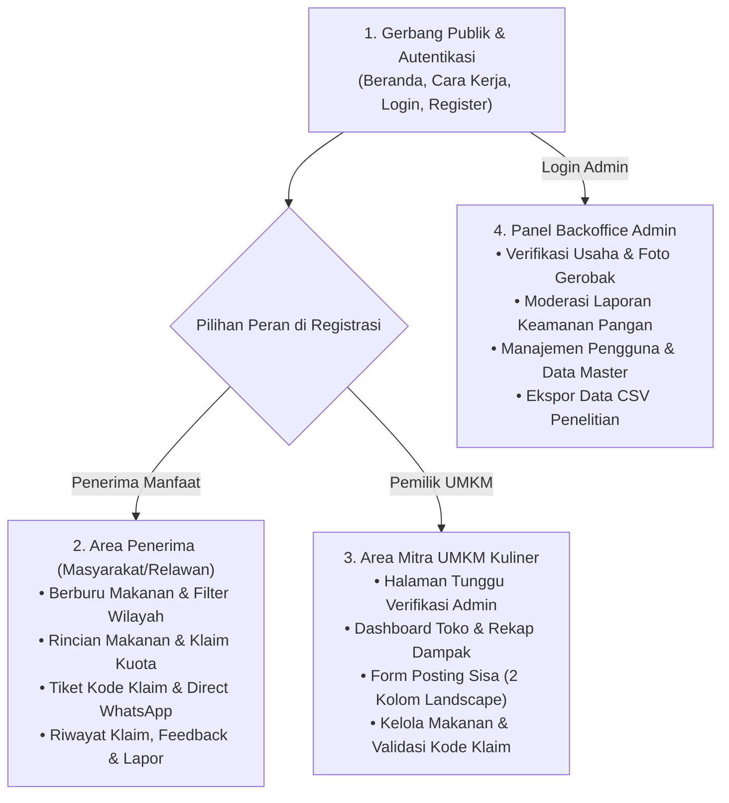

---

#### 12.7.1 Kelompok 1: Halaman Publik & Autentikasi (Gerbang Masuk)

| Kode Layar | Nama Halaman | URL / Rute | Deskripsi & Komponen Utama |
|---|---|---|---|
| **`PAGE-01`** | **Beranda Publik** | `/` | Etalase publik menampilkan hero banner landscape *"Sampurasun Akang/Teteh"*, bilah pencarian & filter kecamatan, kategori jajanan, dan grid 3–4 kolom sisa makanan tersedia hari ini tanpa wajib login. |
| **`PAGE-02`** | **Cara Kerja & FAQ** | `/cara-kerja` | Edukasi alur bagi UMKM (cara posting) dan penerima (etika pengambilan), serta daftar tanya jawab umum seputar donasi makanan sisa. |
| **`PAGE-03`** | **Standar Keamanan Pangan & Syarat** | `/syarat` | Payung hukum & kriteria makanan layak (batas maksimal jam 22.00, bebas basi/alkohol, suhu ruang) untuk melindungi UMKM dari rasa takut dituntut. |
| **`PAGE-04`** | **Layar Pilihan Peran Registrasi** | `/register` | Gerbang awal pendaftaran menampilkan **2 kartu interaktif visual**: Pilihan 1: 🍰 *Pemilik Usaha (UMKM)* vs Pilihan 2: 🤲 *Penerima Manfaat / Warga*. |
| **`PAGE-05A`** | **Formulir Pendaftaran Penerima** | `/register/penerima` | Jalur pendaftaran kilat masyarakat umum (target ≤30 detik): Nama Lengkap, Nomor WhatsApp, Kecamatan Domisili, Password, dan persetujuan syarat. Akun langsung aktif. |
| **`PAGE-05B`** | **Formulir Pendaftaran Mitra UMKM** | `/register/umkm` | Pendaftaran bertahap 2 langkah: Langkah 1 (Akun Pengelola) + Langkah 2 (Profil Toko, Jenis Jajanan, Kecamatan, Alamat Lengkap, dan 1 Unggahan Foto Tempat Usaha/Gerobak untuk verifikasi admin). |
| **`PAGE-06`** | **Halaman Masuk (Login)** | `/login` | Input Nomor WhatsApp/Email & Password. Sistem secara otomatis mendeteksi peran akun (`penerima`, `umkm`, atau `admin`) dan mengarahkan ke dashboard yang sesuai. |
| **`PAGE-07`** | **Lupa Kata Sandi** | `/forgot-password` | Formulir pemulihan kata sandi via tautan reset email atau konfirmasi nomor WhatsApp. |

---

#### 12.7.2 Kelompok 2: Tampilan & Fitur Khusus Penerima (Masyarakat / Relawan)

Fokus antarmuka: **Mencari makanan terdekat, klaim kuota real-time, dan mengambil makanan secara bermartabat**.

```
Struktur Navigasi Atas Penerima:
[Logo SIPANA] Beranda Katalog | Riwayat Klaim Saya | [🎫 Tiket Klaim Aktif] | Akun Saya (Budi)
```

| Kode Layar | Nama Halaman / Modal | URL / Tipe | Deskripsi & Komponen Utama |
|---|---|---|---|
| **`PAGE-08`** | **Beranda Penerima (Katalog Makanan)** | `/penerima/beranda` | Tampilan beranda personal setelah login: sapaan nama penerima, info sisa kuota klaim harian (maks 3x/hari), banner tiket aktif berjalan jika ada makanan yang belum diambil sore ini, bilah filter kecamatan, dan katalog kartu makanan siap klaim. |
| **`PAGE-09`** | **Rincian Makanan (Food Detail)** | `/penerima/makanan/:id` | Layout landscape 2 kolom: Galeri foto makanan di kiri; informasi toko terverifikasi, jam masak, batas ambil, peruntukan konsumsi/pakan, alergen, Google Maps pin, dan tombol `[Ambil Makanan / Klaim]` di kanan. |
| **`PAGE-10`** | **Modal Konfirmasi Klaim** | Modal Pop-up | Pop-up pemilihan jumlah porsi (stepper `[ - ] 2 [ + ]`), **pilihan tujuan pengambilan (`(•) Konsumsi Sendiri` atau `( ) Disalurkan Lagi ke Dhuafa/Relawan`)**, checklist pernyataan keamanan, dan tombol konfirmasi. |
| **`PAGE-11`** | **Modal Tiket Kode Klaim Sukses** | Modal Pop-up | Menampilkan **Kode Klaim Besar (misal `#SPN-4821`)**, countdown batas ambil, alamat toko, dan **Tombol Hijau Direct WhatsApp ke UMKM** dengan format pesan otomatis. |
| **`PAGE-12`** | **Riwayat & Status Klaim Saya** | `/penerima/klaim-saya` | Tab 1: *Klaim Aktif* (tiket digital yang sedang berjalan, tombol lihat kode, tombol batalkan); Tab 2: *Riwayat Selesai* (daftar klaim masa lalu dengan tombol `[Beri Feedback]`). |
| **`PAGE-13`** | **Modal Pembatalan Klaim** | Modal Pop-up | Pilihan alasan pembatalan jika berhalangan hadir. Kuota porsi makanan otomatis dikembalikan ke toko UMKM. |
| **`PAGE-14`** | **Modal Ulasan & Feedback Makanan** | Modal Pop-up | Pop-up penilaian setelah status klaim menjadi "Diambil": konfirmasi kesesuaian makanan `[Ya / Tidak]`, rating bintang 1–5, dan ulasan singkat. |
| **`PAGE-15`** | **Modal Laporkan Makanan** | Modal Pop-up | Formulir aduan darurat jika makanan basi, tidak layak, atau tidak sesuai foto untuk ditinjau oleh tim admin. |
| **`PAGE-16`** | **Pengaturan Profil Penerima** | `/penerima/profil` | Edit data diri, pembaruan nomor WhatsApp, perubahan kecamatan domisili, dan ubah kata sandi. |

---

#### 12.7.3 Kelompok 3: Tampilan & Fitur Khusus Pemilik Usaha (Mitra UMKM)

Fokus antarmuka: **Menerbitkan sisa makanan cepat (≤2 menit), memantau dampak keberkahan porsi, dan memvalidasi serah terima**.

```
Struktur Navigasi Atas UMKM:
[Logo SIPANA] Dashboard Toko | Postingan Saya | Klaim Masuk | [ + Posting Sisa Hari Ini ] | Profil Toko Bu Nur [✓]
```

| Kode Layar | Nama Halaman | URL / Rute | Deskripsi & Komponen Utama |
|---|---|---|---|
| **`PAGE-17`** | **Menunggu Verifikasi Admin** | `/umkm/menunggu-verifikasi` | Halaman transisi khusus UMKM baru: pesan edukasi bahwa data toko dan foto gerobak sedang ditinjau admin dalam 1x24 jam sebelum hak posting aktif. |
| **`PAGE-18`** | **Dashboard Operasional Toko** | `/umkm/dashboard` | Pusat kendali UMKM: Panel 4 kartu metrik dampak sosial (Porsi Terselamatkan, Total Posting, Warga Terbantu, Tingkat Terambil %), widget pencarian kode klaim masuk hari ini, dan status postingan aktif toko. |
| **`PAGE-19`** | **Form Posting Sisa Makanan Baru** | `/umkm/posting-sisa` | Formulir 2 kolom landscape: Kolom kiri (unggah foto otomatis dikompres, peruntukan konsumsi/pakan, tekstur kering/kuah); Kolom kanan (nama kue, porsi, jam masak, batas ambil s.d max 22.00, checklist kepatuhan, tombol `[Terbitkan Postingan]`). |
| **`PAGE-20`** | **Kelola Postingan Makanan Saya** | `/umkm/postingan` | Manajemen seluruh daftar makanan toko: tab filter (*Aktif, Habis, Selesai, Kedaluwarsa*), statistik porsi terambil vs sisa, dan opsi menutup postingan lebih awal. |
| **`PAGE-21`** | **Kelola Klaim & Validasi Serah Terima** | `/umkm/klaim-masuk` | Bilah verifikasi cepat kode klaim `[ #SPN-____ ]` + Tabel daftar warga yang akan datang hari ini dilengkapi tombol aksi: **`[ ✓ Sudah Diambil ]`** dan **`[ ❌ Tidak Datang ]`**. |
| **`PAGE-22`** | **Profil Usaha & Pengaturan Toko** | `/umkm/profil` | Kelola identitas toko, perbarui titik Google Maps, jam buka harian, nomor kontak WhatsApp usaha, dan foto tempat usaha/gerobak. |

---

#### 12.7.4 Kelompok 4: Tampilan & Fitur Khusus Panel Admin (SIPANA Backoffice)

Fokus antarmuka: **Verifikasi mitra UMKM, moderasi keamanan pangan, dan ekspor data penelitian**.

```
Struktur Navigasi Atas Admin:
[Logo SIPANA] Ringkasan Sistem | Verifikasi UMKM (3) | Moderasi Laporan (1) | Data Master | [Ekspor CSV]
```

| Kode Layar | Nama Halaman | URL / Rute | Deskripsi & Komponen Utama |
|---|---|---|---|
| **`PAGE-23`** | **Dashboard Ringkasan Admin** | `/admin/dashboard` | Statistik performa se-Kabupaten Karawang: total porsi tertolong, sebaran per kecamatan, grafik posting harian, dan tombol `[ Ekspor Data CSV ]`. |
| **`PAGE-24`** | **Antrean Verifikasi UMKM** | `/admin/verifikasi-umkm` | Meninjau berkas pendaftaran mitra UMKM baru: nama pemilik, verifikasi foto gerobak/kios, tes kontak WhatsApp, tombol `[ Setujui ]` atau `[ Tolak dengan Catatan ]`. |
| **`PAGE-25`** | **Moderasi Laporan Warga** | `/admin/laporan` | Daftar aduan keluhan pangan: investigasi foto bukti, penanganan otomatis (postingan ditangguhkan jika ≥2 laporan), tombol `[ Laporan Valid (Peringatan Toko) ]` atau `[ Tidak Valid ]`. |
| **`PAGE-26`** | **Manajemen Pengguna** | `/admin/pengguna` | Basis data seluruh akun penerima dan UMKM, riwayat mangkir, serta opsi `[ Blokir Akun ]` bagi pelanggar (misal menjual kembali makanan donasi). |
| **`PAGE-27`** | **Pengelolaan Data Master** | `/admin/data-master` | Manajemen master daftar kecamatan Kabupaten Karawang, kategori jenis jajanan/kue, dan pembaruan teks versi Syarat & Ketentuan Keamanan Pangan. |

---

#### 12.7.5 Matriks Hak Akses Halaman Antar-Peran

| No | Modul / Layar | Pengunjung Publik | Penerima Manfaat | Mitra UMKM Kuliner | Admin Sistem |
|:---:|:---|:---:|:---:|:---:|:---:|
| 1 | `PAGE-01` Beranda Publik Landscape | ✅ | - | - | - |
| 2 | `PAGE-02` Cara Kerja & FAQ | ✅ | ✅ | ✅ | - |
| 3 | `PAGE-03` Standar Keamanan Pangan | ✅ | ✅ | ✅ | - |
| 4 | `PAGE-04` Layar Pilihan 2 Peran (`/register`) | ✅ | - | - | - |
| 5 | `PAGE-05A` Form Daftar Penerima | ✅ | - | - | - |
| 6 | `PAGE-05B` Form Daftar Mitra UMKM | ✅ | - | - | - |
| 7 | `PAGE-06` Halaman Masuk (Login) | ✅ | - | - | - |
| 8 | `PAGE-08` Beranda Penerima (Katalog Makanan) | ❌ | ✅ | ❌ | ❌ |
| 9 | `PAGE-09` Rincian Makanan & Tombol Klaim | ❌ | ✅ | ❌ | ❌ |
| 10 | `PAGE-10 & 11` Modal Klaim & Tiket Kode Klaim | ❌ | ✅ | ❌ | ❌ |
| 11 | `PAGE-12 & 13` Riwayat Klaim & Pembatalan | ❌ | ✅ | ❌ | ❌ |
| 12 | `PAGE-14 & 15` Feedback Rating & Lapor Aduan | ❌ | ✅ | ❌ | ❌ |
| 13 | `PAGE-17` Halaman Menunggu Verifikasi | ❌ | ❌ | ✅ (Khusus Akun Baru) | ❌ |
| 14 | `PAGE-18` Dashboard Operasional Toko UMKM | ❌ | ❌ | ✅ | ❌ |
| 15 | `PAGE-19` Form Posting Sisa (2 Kolom) | ❌ | ❌ | ✅ | ❌ |
| 16 | `PAGE-20` Kelola Postingan Makanan Toko | ❌ | ❌ | ✅ | ❌ |
| 17 | `PAGE-21` Kelola Klaim & Validasi Serah Terima | ❌ | ❌ | ✅ | ❌ |
| 18 | `PAGE-23 s.d 27` Panel Backoffice Admin | ❌ | ❌ | ❌ | ✅ |

---

### 12.8 Spesifikasi Detail Layar & Pemisahan 2 Tampilan Antarmuka (Penerima vs UMKM)

Bagian ini merupakan **acuan utama dan absolut** bagi tim pengembang (*developer*), desainer UI/UX (*Figma Prototype*), maupun asisten kecerdasan buatan (*AI agent*) berikutnya. Seluruh fitur, navigasi, dan antarmuka dipisahkan secara tegas 100% berdasarkan peran pengguna (*role-based UI segregation*) sejak titik pendaftaran (*register*) hingga seluruh fitur operasional harian.

```
┌─────────────────────────────────────────────────────────────────────────────────────────────────┐
│                    FILOSOFI PEMISAHAN DUA ANTARMUKA UTAMA SIPANA                                │
├───────────────────────────────────┬─────────────────────────────────────────────────────────────┤
│ 🍰 AREA MITRA UMKM KULINER        │ 🤲 AREA PENERIMA MANFAAT (WARGA / RELAWAN)                  │
├───────────────────────────────────┼─────────────────────────────────────────────────────────────┤
│ • Fokus: Efisiensi & Kecepatan    │ • Fokus: Kemudahan Pencarian & Kebermartabatan              │
│ • Target Waktu Posting: ≤ 2 Menit │ • Target Waktu Klaim: ≤ 30 Detik                            │
│ • Tampilan: Merchant Dashboard    │ • Tampilan: Consumer Food Catalog & Digital Ticket          │
│ • Fitur Utama:                    │ • Fitur Utama:                                              │
│   1. Posting Sisa Dagangan Cepat  │   1. Eksplorasi Katalog & Filter Kecamatan Karawang         │
│   2. Validasi Kode Klaim Masuk    │   2. Klaim Makanan dengan Pilihan Tujuan (Pribadi/Relawan)  │
│   3. Pantau Kuota Porsi Terambil  │   3. Tiket Digital Kode Unik (#SPN-XXXX) Anti-Canggung      │
│   4. Rekap Dampak Sosial Berkah   │   4. Hubungi WhatsApp UMKM Langsung (Template Otomatis)     │
│   5. Konfirmasi Sudah Diambil     │   5. Riwayat Klaim, Ulasan Feedback & Lapor Aduan           │
└───────────────────────────────────┴─────────────────────────────────────────────────────────────┘
```

---

#### 12.8.1 Struktur Navigasi Horizontal Atas (Navbar Comparison)

Setiap peran memiliki bilah navigasi horizontal atas (*top navbar*) yang berbeda secara eksklusif:

##### 1. Navbar Khusus Pengunjung Publik (Belum Login)
```
+--------------------------------------------------------------------------------------------------------+
| [Logo + text SIPANA]    Beranda   Cari Makanan   Cara Kerja   Keamanan Pangan          [Masuk] [Daftar]|
+--------------------------------------------------------------------------------------------------------+
```

##### 2. Navbar Khusus Penerima Manfaat (Masyarakat / Relawan)
```
+--------------------------------------------------------------------------------------------------------+
| [Logo + text SIPANA]    Katalog Makanan   Riwayat Klaim   [🎫 1 Tiket Aktif (17:00)]   [Akang Budi v]  |
+--------------------------------------------------------------------------------------------------------+
```
*Dropdown Profil Penerima:* `Profil Saya`, `Ganti Kata Sandi`, `Keluar (Logout)`.

##### 3. Navbar Khusus Pemilik Usaha (Mitra UMKM Kuliner)
```
+--------------------------------------------------------------------------------------------------------+
| [Logo + text SIPANA]    Dashboard   Postingan Saya   Klaim Masuk   [+ POSTING SISA HARI INI]  [Bu Nur v]|
+--------------------------------------------------------------------------------------------------------+
```
*Dropdown Profil UMKM:* `Profil Toko & Jam Buka`, `Pengaturan Titik Maps`, `Ganti Kata Sandi`, `Keluar (Logout)`.

##### 4. Navbar Khusus Backoffice Admin
```
+--------------------------------------------------------------------------------------------------------+
| [Logo + text SIPANA]    Ringkasan   Verifikasi UMKM (3)   Aduan Warga (1)   Data Master   [Keluar]     |
+--------------------------------------------------------------------------------------------------------+
```

---

#### 12.8.2 Gerbang Autentikasi & Alur Onboarding 2 Peran

##### `PAGE-04`: Layar Pilihan Peran Registrasi (`/register`)
- **Tujuan:** Memberikan pengalaman *onboarding* yang jelas di awal pendaftaran agar pengguna tidak salah memilih peran.
- **Tata Letak Desktop Landscape:** Judul utama *"Bergabung dengan SIPANA Karawang"*, diikuti oleh **2 kartu pilihan besar yang berjajar berdampingan secara horizontal**:
  - **Kartu Kiri (Pemilik Usaha UMKM):** Ikon kue & gerobak, deskripsi singkat pedagang, poin manfaat (posting sisa mudah, dapat rekap keberkahan porsi, kuota klaim terkontrol), tombol aksi `[ DAFTAR SEBAGAI PEMILIK UMKM ]` yang mengarah ke `/register/umkm`.
  - **Kartu Kanan (Penerima Manfaat / Warga):** Ikon tangan berbagi, deskripsi masyarakat/relawan sosial, poin manfaat (makanan layak gratis, tiket kode klaim rapi, langsung WhatsApp toko), tombol aksi `[ DAFTAR SEBAGAI PENERIMA ]` yang mengarah ke `/register/penerima`.
- **Tautan Bawah:** *"Sudah memiliki akun? Masuk di sini"*.

##### `PAGE-05A`: Formulir Pendaftaran Penerima (`/register/penerima`)
- **Tujuan:** Pendaftaran kilat warga masyarakat (target waktu pengisian ≤ 30 detik).
- **Tata Letak:** 1 Kartu formulir bersih di tengah layar (*clean centered card*).
- **Elemen Input:**
  1. `Nama Lengkap` (Teks, wajib)
  2. `Nomor WhatsApp` (Teks/Telp, contoh: `081234567890`, wajib & unik)
  3. `Kecamatan Domisili di Karawang` (Dropdown pilihan 30 kecamatan di Karawang, wajib)
  4. `Kata Sandi` & `Konfirmasi Kata Sandi` (Password, minimal 6 karakter, wajib)
  5. Checklist: `[X] Saya menyetujui Syarat & Ketentuan Keamanan Pangan SIPANA` (wajib)
- **Tombol Aksi:** `[ Buat Akun Penerima ]`
- **Logika Sistem:** Akun langsung dibuat dengan peran `penerima`, status langsung aktif (tanpa perlu verifikasi admin), langsung login secara otomatis (*auto-login*), dan diarahkan ke `PAGE-08: /penerima/beranda`.

##### `PAGE-05B`: Formulir Pendaftaran Mitra UMKM (`/register/umkm`)
- **Tujuan:** Pendaftaran pelaku usaha kuliner dengan verifikasi tempat usaha/kios.
- **Tata Letak:** Formulir bertahap 2 langkah (*Two-Step Wizard Landscape*):
  - **Langkah 1: Akun Pengelola Usaha**
    - `Nama Pemilik / Penanggung Jawab` (Teks, wajib)
    - `Nomor WhatsApp Usaha` (Teks, wajib & unik, akan dipakai untuk komunikasi klaim)
    - `Email Usaha` (Opsional)
    - `Kata Sandi Akun` (Password, wajib)
  - **Langkah 2: Profil & Bukti Lapak Usaha**
    - `Nama Toko / Usaha Kuliner` (Teks, contoh: *Toko Roti Bu Nur*, wajib)
    - `Jenis / Kategori Makanan` (Dropdown: *Kue Basah & Tradisional, Roti & Pastry, Makanan Ringan / Gorengan, Warung Nasi / Katering, Kafe / Minuman*)
    - `Kecamatan di Karawang` (Dropdown kecamatan domisili usaha, wajib)
    - `Alamat Lengkap Usaha` (Textarea, patokan toko/kios, wajib)
    - `Tautan Google Maps Pin` (URL Google Maps lokasi lapak, opsional)
    - `Unggah 1 Foto Tempat Usaha / Gerobak / Kios` (File gambar maks 3 MB, otomatis dikompres di browser, wajib sebagai bukti validitas ke admin).
    - Checklist: `[X] Saya menyatakan usaha ini beroperasi aktif di Karawang dan bersedia menyalurkan sisa makanan layak secara 100% gratis.`
- **Tombol Aksi:** `[ Ajukan Pendaftaran Kemitraan UMKM ]`
- **Logika Sistem:** Akun dibuat dengan peran `umkm` dan profil usaha berstatus `status_verifikasi = 'menunggu'`. Pengguna diarahkan ke `PAGE-17: /umkm/menunggu-verifikasi`.

##### `PAGE-06`: Halaman Masuk / Login (`/login`)
- **Tujuan:** Pintu masuk tunggal yang cerdas (*smart single sign-on*) untuk seluruh pengguna.
- **Elemen Input:** `Nomor WhatsApp atau Email`, `Kata Sandi`, checkbox `Ingat Saya`.
- **Logika Pengalihan Otomatis (*Smart Role-Based Redirect*):**
  - Jika `role == 'penerima'` ➔ Diarahkan ke `/penerima/beranda`.
  - Jika `role == 'umkm'`:
    - Jika `status_verifikasi == 'menunggu'` ➔ Diarahkan ke `/umkm/menunggu-verifikasi`.
    - Jika `status_verifikasi == 'terverifikasi'` ➔ Diarahkan ke `/umkm/dashboard`.
    - Jika `status_verifikasi == 'ditolak'` ➔ Diarahkan ke `/umkm/menunggu-verifikasi` dengan catatan perbaikan dari admin.
  - Jika `role == 'admin'` ➔ Diarahkan ke `/admin/dashboard`.

---

#### 12.8.3 Spesifikasi Layar & Modal Khusus Penerima Manfaat (`/penerima/*`)

##### `PAGE-08`: Beranda Katalog Makanan Penerima (`/penerima/beranda`)
- **Header Khusus Penerima:** Sapaan ramah *"Sampurasun, [Nama Penerima]! Sisa kuota klaim Anda hari ini: [X dari 3 porsi]"*.
- **Alert Banner Tiket Aktif (Jika Ada):** Jika penerima memiliki klaim berstatus `dipesan` yang belum diambil, tampil pita peringatan berwarna oranye lembut di atas katalog:
  `🎫 Anda memiliki 1 tiket klaim aktif di Toko Roti Bu Nur (Batas Ambil: 17:00 WIB). [Lihat Kode Tiket]`
- **Bilah Pencarian & Filter Terpadu:**
  - Input teks pencarian nama makanan / toko.
  - Dropdown filter kecamatan di Karawang.
  - Filter chip cepat: `[Semua]`, `[🥐 Roti & Pastry]`, `[🍰 Kue Basah]`, `[🥟 Gorengan]`, `[Tekstur Kering]`, `[🌾 Pakan Ternak]`.
- **Grid Katalog Makanan (Responsive 3–4 Kolom Landscape):**
  - Setiap kartu memuat foto makanan 16:9, badge toko terverifikasi, alamat kecamatan, porsi tersisa, jam batas ambil dengan countdown waktu, dan tombol CTA `[Lihat & Klaim]`.
- **Status Kosong (Empty State):** Jika tidak ada makanan di kecamatan yang dipilih, tampil ilustrasi bersahabat: *"Belum ada sisa makanan di kecamatan ini hari ini. Coba cek kecamatan tetangga atau kembali pukul 14.00-16.00 WIB!"*.

##### `PAGE-09`: Rincian Makanan & Informasi Toko (`/penerima/makanan/:id`)
- **Tata Letak Landscape 2 Kolom:**
  - **Kolom Kiri (Visual Makanan):** Foto utama ukuran besar + pratinjau thumbnail (1–4 foto).
  - **Kolom Kanan (Informasi Detail & Aksi):**
    - Judul makanan, nama toko kuliner, badge hijau `[✓ Toko Terverifikasi]`.
    - Alamat lengkap toko & tombol `[🗺️ Buka di Google Maps]`.
    - Tabel ringkas keamanan pangan: Jam selesai dimasak, jam batas ambil (dengan indikator warna: hijau jika >2 jam, oranye jika <1 jam), label peruntukan (Konsumsi Manusia / Pakan), info alergen, dan petunjuk penyimpanan.
    - Sisa kuota porsi yang tersedia real-time.
    - Tombol Utama: `[ AMBIL MAKANAN SEKARANG (KLAIM) ]` (membuka `PAGE-10`).
    - Tombol Sekunder di Bawah: `[ 🚩 Laporkan Postingan Ini ]` (membuka `PAGE-15`).

##### `PAGE-10`: Modal Konfirmasi Klaim (Pop-up Dialog)
- **Tujuan:** Memvalidasi jumlah porsi dan komitmen penerima sebelum kuota dikunci di database.
- **Elemen Antarmuka:**
  1. *Porsi yang Ingin Diambil:* Stepper `[ - ] [ 2 ] [ + ]` (dibatasi antara 1 sampai `maks_porsi_per_klaim`, default 1 atau 2).
  2. *Tujuan Pengambilan Makanan (Pilihan Radio)*:
     - `(•) Untuk Dikonsumsi Sendiri / Keluarga`
     - `( ) Untuk Disalurkan Lagi ke Warga yang Membutuhkan (Relawan Sosial / Dhuafa)`
     - `( ) Untuk Pakan Ternak` (hanya aktif jika makanan berlabel pakan ternak).
  3. *Pernyataan Keamanan Pangan (Checklist Wajib)*:
     - `[X] Saya berjanji akan mengambil makanan di lokasi toko sebelum pukul [Batas Ambil].`
     - `[X] Saya menyetujui Pernyataan Keamanan Pangan & tidak akan menjual kembali makanan ini.`
- **Tombol Aksi:** `[ Batalkan ]` dan `[ Konfirmasi Ambil Makanan ]`.
- **Logika Sistem:** Mengurangi `porsi_tersisa` secara atomik (`lockForUpdate`). Jika berhasil, menutup modal ini dan langsung membuka `PAGE-11`.

##### `PAGE-11`: Modal Tiket Kode Klaim Digital (Pop-up Sukses / Card)
- **Tujuan:** Menampilkan tiket digital anti-canggung (*dignity-first ticket*) untuk ditunjukkan ke kasir UMKM.
- **Elemen Antarmuka:**
  1. **Kotak Tiket Digital Bergaris Putus-putus (*Ticket Cutout Card*):**
     - Label: *"Tunjukkan kode ini ke penjual saat mengambil makanan"*
     - **Kode Klaim Besar & Tebal:** `text-4xl font-black tracking-widest text-[#0F2840]` (contoh: `#SPN-4821`).
     - Nama Penerima, Nama Toko, Jumlah Porsi yang diklaim.
     - Countdown mundur batas jam ambil: `⏳ 01 Jam : 42 Menit Tersisa`.
  2. **Tombol Hijau Direct WhatsApp ke Pemilik Toko:**
     - Tombol lebar mencolok dengan logo WhatsApp: `[ Hubungi Toko via WhatsApp ]`.
     - Tautan langsung membuka WhatsApp Web/Aplikasi dengan format pesan sopan:
       ```
       Sampurasun Toko Roti Bu Nur, saya Budi Santoso telah mengklaim Roti Manis Coklat (2 pcs) dengan Kode Klaim #SPN-4821 di SIPANA. Saya akan datang mengambil makanan sebelum pukul 17.00 WIB. Hatur nuhun!
       ```
  3. Tombol Sekunder: `[ Simpan ke Riwayat Klaim ]` (menutup modal).

##### `PAGE-12`: Riwayat & Status Klaim Saya (`/penerima/klaim-saya`)
- **Tujuan:** Memantau seluruh aktivitas klaim penerima.
- **Tab Navigasi:**
  - **Tab 1: Klaim Aktif (Sedang Berjalan):**
    - Menampilkan kartu tiket makanan yang sedang dipesan hari ini.
    - Informasi toko, jam batas ambil, tombol `[ Lihat Kode Tiket ]`, dan tombol merah `[ Batalkan Pengambilan ]` (membuka `PAGE-13`).
  - **Tab 2: Riwayat Pengambilan Selesai:**
    - Daftar klaim masa lalu dengan lencana status: `[✓ Sudah Diambil]`, `[Dibatalkan]`, atau `[Kedaluwarsa/Tidak Diambil]`.
    - Jika status `Sudah Diambil` dan belum diberi ulasan, muncul tombol oranye `[ ⭐ Beri Feedback ]` (membuka `PAGE-14`).

##### `PAGE-13`: Modal Pembatalan Klaim (Pop-up Dialog)
- **Tujuan:** Memfasilitasi pembatalan beradab agar kuota makanan segera kembali ke etalase untuk orang lain.
- **Elemen Input:** Dropdown alasan pembatalan (*Ada keperluan mendadak, Lokasi terlalu jauh, Sudah mendapat makanan lain, Salah klik klaim*).
- **Logika Sistem:** Mengubah status klaim menjadi `batal`, mengembalikan jumlah porsi ke `porsi_tersisa` pada postingan toko, dan mencatat riwayat pembatalan.

##### `PAGE-14`: Modal Ulasan & Feedback Makanan (Pop-up Dialog)
- **Tujuan:** Menampung aspirasi penerima setelah makanan diambil guna menjaga kualitas mitra UMKM.
- **Elemen Input:**
  1. Pertanyaan Kunci: *"Apakah makanan yang diterima masih bersih, higienis, dan layak konsumsi?"* `[ Ya / Tidak ]`.
  2. Rating Kepuasan Bintang 1 sampai 5.
  3. Komentar singkat / ucapan terima kasih untuk penjual toko.
- **Tombol Aksi:** `[ Kirim Ulasan ]`.

##### `PAGE-15`: Modal Laporkan Postingan Makanan (Pop-up Darurat)
- **Tujuan:** Perlindungan warga jika menemukan makanan tidak higienis atau toko fiktif.
- **Elemen Input:**
  1. Pilihan Kategori Aduan: `Makanan Basi / Berbau`, `Tidak Sesuai Foto / Porsi`, `Toko Tutup Saat Didatangi`, `Keluhan Sakit Setelah Konsumsi`, `Lainnya`.
  2. Deskripsi Kejadian (Textarea).
  3. Unggah 1 Foto Bukti (Opsional).
- **Logika Sistem:** Menyimpan laporan ke tabel `reports`. Jika postingan telah menerima ≥ 2 laporan dari penerima berbeda, sistem otomatis mengubah status postingan menjadi `ditangguhkan` (*auto-quarantine*) untuk ditinjau admin.

##### `PAGE-16`: Pengaturan Profil Penerima (`/penerima/profil`)
- **Tujuan:** Pengelolaan identitas penerima.
- **Formulir:** Ubah Nama, Perbarui Nomor WhatsApp, Ganti Kecamatan Domisili, Ubah Kata Sandi, dan Kartu Statistik Total Porsi yang Berhasil Diselamatkan oleh penerima.

---

#### 12.8.4 Spesifikasi Layar Khusus Pemilik Usaha Kuliner (`/umkm/*`)

##### `PAGE-17`: Halaman Menunggu Verifikasi Admin (`/umkm/menunggu-verifikasi`)
- **Kondisi:** Muncul otomatis jika UMKM baru selesai mendaftar atau profilnya sedang ditinjau.
- **Elemen Antarmuka:**
  - Ilustrasi jam pasir / toko dalam tinjauan.
  - Lencana Status: `⏳ Sedang Ditinjau Admin SIPANA (Maksimal 1 x 24 Jam)`.
  - Penjelasan Edukasi: *"Verifikasi tempat usaha dilakukan demi menjaga keamanan pangan warga Karawang dan kepercayaan bersama. Selama masa peninjauan, fitur posting sisa makanan belum dapat digunakan."*
  - Kartu Ringkasan Data Usaha yang didaftarkan (Nama Usaha, Kecamatan, Alamat, Foto Lapak).
  - Tombol WhatsApp Bantuan: `[ Hubungi Tim Admin SIPANA via WhatsApp ]` jika verifikasi mendesak.

##### `PAGE-18`: Dashboard Operasional Toko UMKM (`/umkm/dashboard`)
- **Header Toko:** Sapaan *"Selamat Datang, [Nama Toko Roti] [✓ Mitra Terverifikasi]"*.
- **Tombol Aksi Utama:** `[ + POSTING SISA DAGANGAN HARI INI ]` (Tombol besar di kanan atas).
- **Panel 4 Kartu Metrik Keberkahan Usaha:**
  1. *Porsi Terselamatkan:* Total makanan yang sukses diserahkan ke warga (misal: `58 Porsi`).
  2. *Total Postingan:* Frekuensi UMKM membagikan sisa dagangan (misal: `14 Kali`).
  3. *Warga Terbantu:* Jumlah warga unik yang pernah mengambil (misal: `29 Orang`).
  4. *Tingkat Terambil (%):* Rasio sukses pengambilan (misal: `86%`).
- **Widget Validasi Cepat Kode Klaim:**
  - Kotak pencarian instan: `[ Masukkan Kode Klaim #SPN-____ ] [ Verifikasi & Selesaikan ]`. Kasir UMKM cukup mengetikkan 4 digit kode yang dibawa penerima untuk menandai klaim telah diambil tanpa perlu mencari di daftar.
- **Tabel Klaim Masuk Hari Ini (Menunggu Pengambilan Sore Ini):**
  - Menampilkan daftar nama penerima yang akan datang sore ini, jumlah porsi, batas waktu, dan tombol aksi serah terima.

##### `PAGE-19`: Formulir Posting Sisa Makanan Baru (`/umkm/posting-sisa`)
- **Target Desain:** Selesai diisi dalam waktu kurang dari 2 menit (*ultra-streamlined layout*).
- **Tata Letak Landscape 2 Kolom:**
  - **Kolom Kiri (Media & Karakteristik):**
    1. *Unggah Foto Makanan:* Kotak seret & lepas (*drag & drop*) untuk 1–4 foto. Foto langsung dikompresi otomatis di browser sebelum unggah.
    2. *Peruntukan Makanan:* Radio Button `(•) Konsumsi Manusia (Layak Bersih)` atau `( ) Pakan Ternak`.
    3. *Tekstur Makanan:* Radio Button `(•) Makanan Kering (Roti, Kue Kering)` atau `( ) Makanan Basah / Berkuah`.
    4. *Info Alergen (Opsional):* Checkbox kacang, susu, telur, gluten.
    5. *Petunjuk Penyimpanan:* Suhu ruang / lemari pendingin.
  - **Kolom Kanan (Rincian & Kepatuhan):**
    1. *Nama Makanan:* Teks (contoh: *Roti Sobek Coklat & Keju*).
    2. *Kategori:* Dropdown (*Kue Basah, Roti & Pastry, Gorengan, dsb.*).
    3. *Jumlah Porsi Sisa & Satuan:* Input angka + Dropdown satuan (*pcs, kotak, bungkus, porsi*).
    4. *Batas Maksimal Klaim per Orang:* Default `2 pcs` (mencegah penimbunan).
    5. *Jam Selesai Dimasak:* Waktu (default: jam sekarang atau jam pagi toko).
    6. *Batas Waktu Pengambilan:* Waktu (maksimal pukul 22.00 hari ini).
    7. *Checklist Kepatuhan Keamanan Pangan (4 butir wajib centang):*
       - `[X] Makanan dibuat/dimasak hari ini dan belum pernah dijual ulang.`
       - `[X] Makanan dalam kondisi bersih, tidak basi, tidak berbau, dan tidak berjamur.`
       - `[X] Saya menyetujui penyerahan sisa makanan ini secara 100% gratis.`
       - `[X] Jam masak dan deskripsi yang diisi adalah benar sesuai kondisi sebenarnya.`
- **Tombol Aksi:** `[ Terbitkan Sisa Makanan Sekarang ]`.

##### `PAGE-20`: Kelola Postingan Makanan Toko (`/umkm/postingan`)
- **Tujuan:** Manajemen siklus hidup postingan toko.
- **Tab Filter:** `[Aktif (Sedang Berjalan)]`, `[Habis Terklaim]`, `[Selesai]`, `[Kedaluwarsa]`.
- **Tabel Daftar Postingan:**
  - Kolom: Foto mini, Nama Makanan, Tanggal & Jam Masak, Batas Ambil, Progress Kuota (`4 dari 6 Porsi Terklaim`), Status Lencana.
  - Aksi: `[Lihat Rincian Klaim]`, `[Tutup Postingan Lebih Awal]` (opsi darurat jika toko mendadak harus tutup).

##### `PAGE-21`: Kelola Klaim & Validasi Serah Terima (`/umkm/klaim-masuk`)
- **Tujuan:** Lokasi kasir/staf toko memvalidasi kedatangan warga yang mengambil makanan.
- **Bilah Verifikasi Cepat:** Input kode klaim `#SPN-____` + tombol cek instan.
- **Tabel Daftar Klaim:**
  - Kolom: Kode Klaim, Waktu Klaim, Nama Penerima, Nomor WhatsApp (tautan direct chat), Jumlah Porsi, Batas Jam Ambil.
  - **Dua Tombol Aksi Kunci Kasir:**
    - **`[ ✓ Sudah Diambil ]` (Tombol Hijau):** Mengubah status klaim menjadi `diambil`, mencatat jam serah terima, menambah angka rekap porsi terselamatkan toko, dan memicu form feedback kepuasan di akun penerima.
    - **`[ ❌ Tidak Datang ]` (Tombol Abu-Abu / Merah):** Mengubah status klaim menjadi `tidak_diambil` jika lewat jam batas ambil dan penerima tidak datang tanpa kabar.

##### `PAGE-22`: Profil Usaha & Pengaturan Toko (`/umkm/profil`)
- **Tujuan:** Pengaturan identitas dan lokasi gerai UMKM.
- **Elemen:** Nama Usaha, Deskripsi Lapak, Alamat Lengkap, Titik Pin Google Maps, Nomor WhatsApp Usaha, Jam Operasional Harian, dan Unggahan Pembaruan Foto Gerobak/Kios.

---

#### 12.8.5 Spesifikasi Layar Khusus Panel Backoffice Admin (`/admin/*`)

##### `PAGE-23`: Dashboard Ringkasan Admin (`/admin/dashboard`)
- Metrik akumulasi se-Kabupaten Karawang: Total Porsi Terselamatkan, Jumlah Mitra UMKM Terverifikasi, Jumlah Penerima Terdaftar, Jumlah Aduan Aktif.
- Grafik sebaran postingan per kecamatan di Karawang.
- Tombol Aksi: `[ 📥 Ekspor Seluruh Data Penelitian ke CSV ]`.

##### `PAGE-24`: Antrean Verifikasi Mitra UMKM (`/admin/verifikasi-umkm`)
- Daftar UMKM baru yang mengajukan pendaftaran: Nama Toko, Nama Pemilik, Kecamatan, Alamat, Nomor WhatsApp, dan Pratinjau Foto Kios/Gerobak.
- Tombol Aksi: `[ Hubungi WA Toko ]`, `[ ✓ Setujui Mitra ]`, `[ ❌ Tolak dengan Catatan Perbaikan ]`.

##### `PAGE-25`: Moderasi Laporan Warga (`/admin/laporan`)
- Daftar keluhan pangan dari masyarakat: Nama Pelapor, Postingan Terkait, Toko Terkait, Alasan Aduan, Bukti Foto Aduan.
- Aksi Admin: `[ Validasi Laporan (Tegur Toko & Tangguhkan) ]` atau `[ Laporan Tidak Valid (Pulihkan Postingan) ]`.

##### `PAGE-26`: Manajemen Pengguna Sistem (`/admin/pengguna`)
- Basis data seluruh pengguna (Penerima dan UMKM).
- Riwayat kedisiplinan: Jumlah klaim sukses, riwayat mangkir (*no-show*), dan tombol `[ Blokir Akun ]` untuk pelanggar aturan bisnis (misal menjual kembali makanan).

##### `PAGE-27`: Pengelolaan Data Master (`/admin/data-master`)
- Manajemen daftar resmi kecamatan di Kabupaten Karawang, master kategori makanan ringan, dan editor teks syarat & ketentuan keamanan pangan.

---

### 12.9 Panduan Pembuatan Prototype Figma & Arsitektur Rute Middleware

#### 12.9.1 Panduan Ukuran Frame & Desain di Figma
1. **Desktop Landscape Frame (Ukuran Utama):** Gunakan frame **Desktop 1440 × 900 px** dengan kontainer konten maksimal **1280 px (`max-w-7xl`)** di tengah layar (*centered content*).
2. **Mobile Responsive Frame (Pendukung):** Gunakan frame **iPhone 14 / 15 (390 × 844 px)** untuk menguji responsivitas kartu makanan yang bertumpuk menjadi 1 kolom.
3. **Pemberian Warna Sesuai Token:**
   - Background Canvas: `#F8FAFC`
   - Navbar & Card Surface: `#FFFFFF`
   - Primary Accent: `#AEDAEF` (Soft Sky Blue)
   - Brand Dark / Text Utama: `#0F2840` (Deep Marine Navy)
   - Status Oranye: `#FA8C16` (Countdown & Porsi Menipis)
   - Status Hijau: `#10B981` (Toko Terverifikasi & Sukses Ambil)
4. **Font:** Plus Jakarta Sans (Google Fonts) di seluruh teks antarmuka.

#### 12.9.2 Arsitektur Rute & Proteksi Akses (Laravel Middleware)

Untuk menjamin pemisahan 100% antar-peran di sisi kode (Laravel 11 + Inertia.js):

```php
// routes/web.php

// 1. Rute Terbuka (Pengunjung Publik / Tamu)
Route::get('/', [PublicFoodController::class, 'index'])->name('home');
Route::get('/cara-kerja', [PageController::class, 'caraKerja'])->name('cara-kerja');
Route::get('/syarat', [PageController::class, 'syarat'])->name('syarat');

// 2. Rute Autentikasi Tamu (Guest Only)
Route::middleware('guest')->group(function () {
    Route::get('/register', [AuthController::class, 'registerRoleSelect'])->name('register');
    Route::get('/register/penerima', [AuthController::class, 'registerPenerima'])->name('register.penerima');
    Route::post('/register/penerima', [AuthController::class, 'storePenerima'])->name('register.penerima.store');
    Route::get('/register/umkm', [AuthController::class, 'registerUmkm'])->name('register.umkm');
    Route::post('/register/umkm', [AuthController::class, 'storeUmkm'])->name('register.umkm.store');
    Route::get('/login', [AuthController::class, 'login'])->name('login');
    Route::post('/login', [AuthController::class, 'authenticate'])->name('login.authenticate');
});

// 3. Rute Khusus Penerima (Wajib Login + Role 'penerima')
Route::middleware(['auth', 'role:penerima'])->prefix('penerima')->name('penerima.')->group(function () {
    Route::get('/beranda', [PenerimaController::class, 'beranda'])->name('beranda');
    Route::get('/makanan/{id}', [PenerimaController::class, 'foodDetail'])->name('makanan.detail');
    Route::post('/makanan/{id}/klaim', [ClaimController::class, 'store'])->name('klaim.store');
    Route::get('/klaim-saya', [ClaimController::class, 'myClaims'])->name('klaim.index');
    Route::post('/klaim/{id}/batal', [ClaimController::class, 'cancel'])->name('klaim.cancel');
    Route::post('/klaim/{id}/feedback', [FeedbackController::class, 'store'])->name('feedback.store');
    Route::post('/makanan/{id}/lapor', [ReportController::class, 'store'])->name('lapor.store');
    Route::get('/profil', [PenerimaController::class, 'profile'])->name('profil');
});

// 4. Rute Khusus Mitra UMKM (Wajib Login + Role 'umkm')
Route::middleware(['auth', 'role:umkm'])->prefix('umkm')->name('umkm.')->group(function () {
    // Rute Tunggu Verifikasi (Bisa diakses saat akun belum terverifikasi)
    Route::get('/menunggu-verifikasi', [UmkmController::class, 'waitingVerification'])->name('waiting');

    // Rute Operasional UMKM (Wajib Terverifikasi)
    Route::middleware('umkm.verified')->group(function () {
        Route::get('/dashboard', [UmkmDashboardController::class, 'index'])->name('dashboard');
        Route::get('/posting-sisa', [FoodPostController::class, 'create'])->name('posting.create');
        Route::post('/posting-sisa', [FoodPostController::class, 'store'])->name('posting.store');
        Route::get('/postingan', [FoodPostController::class, 'index'])->name('posting.index');
        Route::post('/postingan/{id}/tutup', [FoodPostController::class, 'closeEarly'])->name('posting.close');
        Route::get('/klaim-masuk', [UmkmClaimController::class, 'index'])->name('klaim.index');
        Route::post('/klaim/{id}/verifikasi-ambil', [UmkmClaimController::class, 'markPickedUp'])->name('klaim.pickup');
        Route::post('/klaim/{id}/tandai-mangkir', [UmkmClaimController::class, 'markNoShow'])->name('klaim.noshow');
        Route::get('/profil', [UmkmController::class, 'profile'])->name('profil');
    });
});

// 5. Rute Khusus Backoffice Admin (Wajib Login + Role 'admin')
Route::middleware(['auth', 'role:admin'])->prefix('admin')->name('admin.')->group(function () {
    Route::get('/dashboard', [AdminDashboardController::class, 'index'])->name('dashboard');
    Route::get('/verifikasi-umkm', [AdminVerificationController::class, 'index'])->name('verifikasi.index');
    Route::post('/verifikasi-umkm/{id}/setujui', [AdminVerificationController::class, 'approve'])->name('verifikasi.approve');
    Route::post('/verifikasi-umkm/{id}/tolak', [AdminVerificationController::class, 'reject'])->name('verifikasi.reject');
    Route::get('/laporan', [AdminReportController::class, 'index'])->name('laporan.index');
    Route::get('/pengguna', [AdminUserController::class, 'index'])->name('pengguna.index');
    Route::get('/data-master', [AdminMasterController::class, 'index'])->name('master.index');
    Route::get('/ekspor-csv', [AdminExportController::class, 'exportCsv'])->name('ekspor.csv');
});
```

---

## 13. Arsitektur Teknologi dan Fullstack Implementation

Berdasarkan pengalaman tim dan lingkungan pengembangan lokal di Laragon (`c:\laragon\www\SIPANA`), arsitektur yang dipilih adalah **Laravel 11 (Backend) + React 19 (Frontend) + Tailwind CSS v4**.

```
┌────────────────────────────────────────────────────────────────────────┐
│                   ARSITEKTUR LENGKAP STACK SIPANA                      │
├────────────────────┬───────────────────────────────────────────────────┤
│ Layer              │ Pilihan Teknologi & Penjelasan                    │
├────────────────────┼───────────────────────────────────────────────────┤
│ Backend Framework  │ Laravel 11.x (PHP 8.2+) di Laragon                │
│ Frontend Engine    │ React 19 + Tailwind CSS v4 (@theme directive)     │
│ Penghubung Stack   │ Inertia.js (Modern Monolith) / Vite SPA           │
│ Database           │ MySQL 8.x / MariaDB (ACID Transaction)            │
│ Kompresi Gambar    │ browser-image-compression (di sisi HP UMKM)       │
│ Set Ikon           │ Lucide React (clean, scalable, ringan)            │
│ Integrasi Komunikasi│ WhatsApp Direct Link (wa.me) tanpa chat engine    │
│ Penjadwal Otomatis │ Laravel Task Scheduling (Cron kedaluwarsa)        │
└────────────────────┴───────────────────────────────────────────────────┘
```

### 13.1 Pilihan Penerapan: Laravel 11 + Inertia.js + React (Sangat Disarankan)

Model **Modern Monolith** dengan Inertia.js adalah opsi tercepat dan paling efisien untuk mengejar tenggat waktu bulan November:
- **Tanpa Pusing CORS & Token JWT**: Menggunakan autentikasi sesi bawaan Laravel yang aman dan terlindungi CSRF.
- **Autentikasi Instan**: Cukup menggunakan starter kit `Laravel Breeze (React)`. Halaman Login, Register, dan Profil sudah langsung berbentuk komponen React siap pakai.
- **Pengiriman Data Cepat**: Controller Laravel langsung me-*render* komponen React beserta props:
  ```php
  // FoodPostController.php
  return Inertia::render('Food/Index', [
      'posts' => FoodPost::with('umkm')->where('status', 'tersedia')->get(),
      'kecamatanList' => Kecamatan::all(),
  ]);
  ```

---

### 13.2 Prinsip Anti-Overengineering (Menghindari Kompleksitas Sia-sia)

Untuk menjaga proyek tetap ramping, cepat selesai, dan mudah dipertanggungjawabkan:
1. **TIDAK MENGGUNAKAN Payment Gateway / Wallet / Escrow**: Makanan sisa UMKM **selalu 100% gratis** (sesuai aturan bisnis **BR-03**). Modul Midtrans, saldo dompet, dan penahanan dana dihilangkan sepenuhnya.
2. **TIDAK MENGGUNAKAN WebSocket Chat Engine (Reverb/Echo)**: Dari hasil survei **T5**, UMKM dan masyarakat Karawang menolak fitur chat baru yang rumit dan secara tegas meminta **tombol langsung ke WhatsApp** (`wa.me`). Sistem hanya mencatat klaim dan memunculkan tombol WhatsApp dengan pesan yang sudah terisi otomatis.
3. **Kompresi Foto di Sisi Klien (*Client-Side Compression*)**:
   Sebelum foto makanan diunggah ke server Laravel, React mengompres ukuran foto (misal dari 5 MB menjadi <300 KB) menggunakan library `browser-image-compression`. Hal ini memastikan proses posting oleh UMKM memakan waktu kurang dari 2 menit dan sangat hemat kuota data seluler.

---

### 13.3 Komponen Pendukung Utama

| Kebutuhan Teknis | Solusi yang Diterapkan |
|---|---|
| **Penjadwal Kedaluwarsa** | Laravel Task Scheduling (`$schedule->command('sipana:check-expired')->everyTenMinutes()`). Menutup postingan yang lewat jam ambil dan mengubah status klaim yang tidak diambil. |
| **Pencegahan Rebutan Kuota (*Race Condition*)** | Penguncian baris transaksi database atomik: `DB::transaction()` dengan `FoodPost::where(...)->lockForUpdate()`. |
| **Integrasi WhatsApp** | Helper URL encode murni: `https://wa.me/628xxx?text=Halo%20Toko%20Roti...` |
| **Integrasi Peta** | Menggunakan kolom `maps_url` (Google Maps Pin) tanpa perlu memuat Google Maps JavaScript API berbayar. |

---

## 14. Indikator Keberhasilan dan Data yang Dicatat Sistem

Menghubungkan tabel indikator di laporan dengan data yang benar-benar tersimpan, supaya tiap angka dapat dihitung.

| Indikator | Baseline survei (n sekarang) | Target usulan | Cara hitung dari sistem |
|---|---|---|---|
| **Adopsi UMKM** | 4/11 "ya", 7/11 "mungkin", 0 menolak | ≥10 UMKM terverifikasi; ≥70% posting ≥1x/minggu | `COUNT(umkm_profiles WHERE status_verifikasi='terverifikasi')`; posting per minggu dari `food_posts.created_at` |
| **Porsi terselamatkan dan terambil** | 10/11 UMKM menyalurkan informal; belum ada kanal | ≥70% porsi yang diposting terambil | `SUM(claims.jumlah WHERE status='diambil') / SUM(food_posts.jumlah_total)` |
| **Kemudahan bagi UMKM** | 7/11 bersyarat "tergantung kemudahan" | ≥80% UMKM menilai mudah (skor 4-5); posting ≤2 menit | Kuesioner SUS/skala 1-5 setelah uji; waktu isi dari log (awal buka formulir sampai terbit) |
| **Kepercayaan dan kepuasan penerima** | Manfaat 4,64/5; minat 4,0/5 | Rating rata-rata ≥4/5 | `AVG(feedbacks.rating)`; `% feedbacks.makanan_sesuai = 1` |
| **Keamanan pangan** | 5/14 ragu soal keamanan/kebersihan | 0 keluhan sakit; ≥90% unggahan memuat foto dan jam masak | `COUNT(reports WHERE alasan='keluhan_sakit' AND status='valid')`. Catatan: kolom foto dan jam masak wajib, jadi indikator ini bernilai 100% secara otomatis. Ganti dengan "% laporan basi/tidak sesuai foto yang valid ≤ 5% dari total postingan" |
| **Kesadaran masyarakat** | 11/14 (79%) belum tahu platform serupa | Pengunjung dari ≥3 kecamatan; ≥5 relawan | Analytics wilayah pengunjung; `COUNT(claims DISTINCT kecamatan penerima)`; `COUNT(volunteers)` (tahap 2) |
| **Kepatuhan pengambilan** | - | ≥80% klaim berstatus `diambil` | `COUNT(claims diambil) / COUNT(claims selain batal)` |
| **Waktu klaim** | - | Rata-rata klaim pertama ≤60 menit setelah posting | `claims.claimed_at - food_posts.created_at` |
| **Usabilitas sistem** | - | Skor SUS ≥68 | Kuesioner SUS 10 butir, 15-30 pengguna |

> **Penting:** data survei digunakan sebagai **baseline**. Hindari menyebut kesediaan "bersedia memakai" sebagai bukti keberhasilan, karena itu hanya niat. Bukti keberhasilan datang dari uji coba (data sistem dan SUS).

---

## 15. Skenario Pengujian (Black-Box)

| ID | Use case | Skenario | Data uji | Hasil yang diharapkan |
|---|---|---|---|---|
| TC-01 | UC-05 | Daftar dengan data valid | Email/WA baru | Akun terbuat |
| TC-02 | UC-05 | Daftar dengan email sudah terdaftar | Email lama | Ditolak dengan pesan jelas |
| TC-03 | UC-14 | Posting oleh UMKM belum terverifikasi | Akun status menunggu | Ditolak, diarahkan ke verifikasi |
| TC-04 | UC-14 | Posting tanpa foto | Foto kosong | Ditolak, pesan per kolom |
| TC-05 | UC-14 | Posting dengan jam masak di masa depan | Jam > sekarang | Ditolak |
| TC-06 | UC-14 | Posting valid | Data lengkap, checklist dicentang | Tampil di beranda, status `tersedia` |
| TC-07 | UC-02 | Filter kecamatan | Karawang Barat | Hanya postingan di kecamatan itu |
| TC-08 | UC-07 | Klaim sah | Jumlah ≤ maks per klaim | Klaim `dipesan`, kuota berkurang, tombol WA muncul |
| TC-09 | UC-07 | Klaim melebihi kuota | Jumlah > sisa | Ditolak |
| TC-10 | UC-07 | Dua penerima klaim bersamaan sisa 1 | Klaim paralel | Hanya satu berhasil |
| TC-11 | UC-07 | Klaim melebihi batas klaim aktif harian | Klaim ke-4 | Ditolak dengan alasan |
| TC-12 | UC-07 | Klaim setelah batas ambil | Waktu lewat | Ditolak |
| TC-13 | UC-09 | Batalkan klaim | Klaim aktif | Status `batal`, kuota kembali |
| TC-14 | UC-16 | Konfirmasi "sudah diambil" | Klaim `dipesan` | Status `diambil`, rekap bertambah |
| TC-15 | UC-24 | Kedaluwarsa otomatis | Batas ambil lewat | Postingan `kedaluwarsa`, klaim `tidak_diambil` |
| TC-16 | UC-11 | Lapor postingan | Alasan "basi" | Laporan tersimpan, admin diberi tahu |
| TC-17 | UC-11 | Dua pelapor berbeda | Laporan ke-2 | Postingan `ditangguhkan` otomatis |
| TC-18 | UC-18 | Verifikasi UMKM | Pengajuan menunggu | Status `terverifikasi`, bisa memposting |
| TC-19 | UC-12 | Feedback | Klaim `diambil` | Tersimpan; feedback kedua ditolak |
| TC-20 | F18 | Privasi nomor WA | Penerima A membuka klaim penerima B | Nomor tidak terlihat |
| TC-21 | UC-17 | Dashboard UMKM | Ada data klaim | Angka rekap sesuai database |
| TC-22 | NFR-02 | Tampilan di HP (lebar 360 px) | Semua halaman inti | Tidak ada scroll horizontal, tombol mudah ditekan |

---

## 16. Batasan dan Pengembangan Lanjutan

### 16.1 Batasan sistem (tulis di laporan dan naskah)

- Wilayah: Kabupaten Karawang; pemberi hanya UMKM kuliner terverifikasi.
- Makanan gratis; tidak ada pembayaran, pengiriman, atau donasi uang.
- Komunikasi lewat WhatsApp pribadi pengguna; SIPANA tidak menjadi penjamin kondisi makanan (hanya menghubungkan dan menyediakan mekanisme kepercayaan).
- Radius jarak, notifikasi otomatis, relawan penyalur, OTP, dan rating terakumulasi belum ada pada versi awal.
- Verifikasi UMKM manual, sehingga kapasitasnya terbatas pada jumlah admin.

### 16.2 Keterbatasan data survei

- Sampel kecil (25), non-probabilitas, didominasi UMKM kue/roti/jajanan (9 dari 11) dan tiga kecamatan.
- Hasil UMKM belum mewakili warung makan matang, yang risiko keamanan pangannya lebih tinggi.
- Pertanyaan minat/manfaat rentan bias persetujuan (responden cenderung menjawab positif).
- Tidak ada UMKM yang memilih "dibuang", sehingga klaim "makanan terbuang" harus ditulis hati-hati. Dukungan data tentang volume pemborosan perlu ditambah dari sumber resmi (Bappenas/FAO/DLHK).

### 16.3 Pengembangan lanjutan

| Tahap | Fitur |
|---|---|
| **Tahap 2** | Notifikasi (WhatsApp/email), pendaftaran relawan penyalur, pencarian radius jarak, verifikasi OTP, rating terakumulasi per UMKM dan lencana |
| **Tahap 3** | Perluasan ke kabupaten lain (tabel kecamatan sudah generik), kemitraan dengan komunitas dan panti, berbagi barang non-makanan, laporan dampak publik |

---

## 17. Rencana Kerja sampai November

Pembagian peran (3 orang): **A = developer**, **B = UI/UX + frontend**, **C = riset + penulis**. Semua ikut menyebar survei.

| Minggu | Tanggal | A (Developer) | B (UI/UX + Frontend) | C (Riset + Penulis) |
|---|---|---|---|---|
| **2** | 15-21 Okt | Siapkan proyek dan database (bagian 11), login, peran, profil UMKM + verifikasi admin | Wireframe Figma 4 halaman (bagian 12), komponen UI | Perbarui laporan (bagian 18), lanjut sebar survei (target UMKM 30+, masyarakat 100+), kajian pustaka 5-10 jurnal |
| **3** | 22-28 Okt | Posting, daftar/filter, detail, klaim atomik, kedaluwarsa otomatis, lapor | Sambungkan UI, halaman Cara Kerja/Syarat, dashboard UMKM | Bab Pendahuluan, Tinjauan Pustaka, Metode; siapkan kuesioner SUS dan skenario uji |
| **3 (akhir)** | 28 Okt | **Fitur dibekukan**; deploy online | | |
| **4** | 29 Okt - 4 Nov | Perbaikan bug, seed data UMKM mitra | Black-box testing (bagian 15), uji tampilan HP | Uji coba terbatas (UMKM mitra dan penerima), SUS 15-30 pengguna; bab Hasil |
| **5** | 5-11 Nov | Cadangan, perbaikan akhir | Dokumentasi, tangkapan layar | Revisi naskah, bimbingan Bu Rini, submit |

**Prinsip:** MVP (F01-F18) dikerjakan lebih dulu; MVP+ (F19, F20) hanya jika waktu cukup; Tahap 2 cukup ditulis di naskah.

**Urutan pengerjaan yang disarankan (dependensi):**
`kecamatan, users, terms` → `umkm_profiles` (+ verifikasi) → `food_categories, food_posts, post_photos` → `claims` (+ kuota atomik) → penjadwal kedaluwarsa → `reports` → dashboard → `feedbacks`.

---

## 18. Catatan Sinkronisasi dengan Laporan Sebelumnya

Laporan **Progress Project Kelompok 6** yang sudah dibuat memakai data **21 responden (7 UMKM, 14 masyarakat)**. CSV terbaru berisi **25 responden (11 UMKM, 14 masyarakat)**. Jumlah masyarakat sama, tetapi **angka UMKM berubah**. Jika laporan diperbarui, ganti angka berikut:

| Butir laporan | Versi lama (n=7) | Versi baru (n=11) |
|---|---|---|
| Total responden | 21 | **25** |
| UMKM dagangan tidak habis ≥2-3x/minggu | 5/7 (71%) | **9/11 (82%)** |
| Sisa pasti sebelum 15.00 | 5/7 (71%) | **8/11 (73%)** |
| Penyaluran informal | 6/7 (86%) | **10/11 (91%)** |
| UMKM takut dituntut | 3/7 (43%) | **6/11 (55%)** |
| UMKM tidak ada keraguan | 4/7 (57%) | **4/11 (36%)** |
| Bersedia memakai website | 1 "ya", 6 "mungkin" | **4 "ya", 7 "mungkin"**, 0 menolak |
| Posting cepat sebagai fitur utama | 3/7 (43%) | **7/11 (64%)** |
| Konfirmasi serah terima | 2/7 (29%) | **5/11 (45%)** |
| Penerima terverifikasi | 1/7 (14%) | **5/11 (45%)** |
| Pilihan peruntukan | 1/7 (14%) | **5/11 (45%)** |
| Lokasi UMKM | Karawang Barat 4, Telukjambe Timur 3 | **Karawang Barat 5, Telukjambe Timur 4, Karawang Timur 2** |
| Jenis usaha | kue/roti 5, katering 1, kafe 1 | **kue/roti 9, katering 1, kafe 1** |

Angka masyarakat (n=14) **tidak berubah**: minat rata-rata 4,0 (10/14), manfaat 4,64 (12/14), 11/14 tidak tahu platform.

**Temuan baru yang layak masuk laporan:** rata-rata kesediaan memberi gratis UMKM adalah **3,64/5**, dengan pola tajam: yang takut dituntut rata-rata **2,67**, yang tidak takut **4,8**. Ini langsung membenarkan prioritas Tinggi untuk fitur syarat dan ketentuan, verifikasi, dan pernyataan keamanan (T2). Tulis keterbatasan sampel kecil di sampingnya.

**Konsistensi dengan alur di laporan (Gambar 1):** laporan menyebut "klaim via WhatsApp". Dokumen ini menyempurnakannya menjadi **klaim tercatat di sistem + tombol WhatsApp** (F08 dan F09), supaya jumlah porsi terselamatkan dapat dihitung. Perbarui keterangan di langkah 5 pada diagram alur laporan. Selain itu, fitur "radius jarak <1 km" di laporan menjadi **tahap 2** (MVP memakai filter kecamatan), jadi sesuaikan kotak "<1 km" di Gambar 1.
